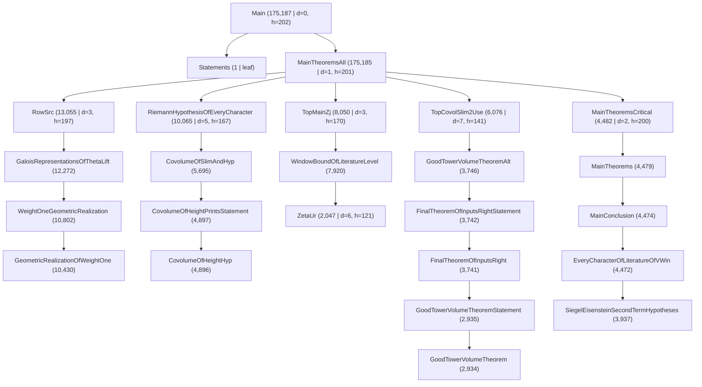

# Proof Spine & Structural DAG Analysis

Analysis of the Lean 4 proof import DAG (`175,187` modules, `17,374,215` lines, `753,261` internal edges) generated from [graph.sqlite](file:///home/ubuntu/riemann_proof/analysis/data/graph.sqlite) and [meta.json](file:///home/ubuntu/riemann_proof/analysis/data/meta.json) via [analyze_spine.py](file:///home/ubuntu/riemann_proof/analysis/proof_spine/analyze_spine.py) (full computed metrics in [spine_metrics.json](file:///home/ubuntu/riemann_proof/analysis/proof_spine/spine_metrics.json), interactive explorer in [spine_dashboard.html](file:///home/ubuntu/riemann_proof/analysis/proof_spine/spine_dashboard.html)).

> **Edge Orientation Convention:** Throughout [graph.sqlite](file:///home/ubuntu/riemann_proof/analysis/data/graph.sqlite) and this report, a directed edge `(u, v)` means module `u` **imports** `v` (`u` depends on `v`). Hence `Main` is the unique root/source (`in_degree = 0`), foundational leaf modules have `out_degree = 0`, `in_degree` measures direct dependents, and `out_degree` measures direct imports.

---

## Executive Summary

| Structural Metric | Verified Value | Notes |
|---|---:|---|
| Total `.lean` modules | `175,187` | All `175,187` (`100.0%`) reachable from [Main.lean](file:///home/ubuntu/riemann_proof/lean/src/Main.lean) (`0` unreachable) |
| Total internal edges | `753,261` | Strict DAG (`0` cycles; RPO invariant verified across all edges) |
| Unique root source (`in_degree = 0`) | `1` | [Main.lean](file:///home/ubuntu/riemann_proof/lean/src/Main.lean) |
| Leaf modules (`out_degree = 0`) | `5,927` | `615,171` lines, `21,610` theorems, `13,624` defs; `0` leaves lack external imports |
| Maximum distance from `Main` | `43` | Peak file density at `dist = 10` (`15,539` files), `11` (`15,237`), `12` (`15,095`) |
| Maximum height from leaves | `202` | `202` edges / `203` modules (`1,008` distinct length-202 paths across `230` modules) |
| Total `Main` → leaf directed paths | `97,485,885,444,945,919,175,668` | `≈ 9.75 × 10²²` paths (`log₁₀ = 22.989`) |
| Top non-root dominator bottleneck | `175,185` (`99.999%`) | [MainTheoremsAll.lean](file:///home/ubuntu/riemann_proof/lean/src/Supplements/Kernels/MainTheoremsAll.lean) dominates all modules except `Main` and `Statements` |
| Non-trivial dominators (`dom_subtree_size > 1`) | `64,465` | `11,438` dominate `≥ 10` files; `957` dominate `≥ 100`; `46` dominate `≥ 1,000`; `11` dominate `≥ 5,000` |

Two structural phenomena define this codebase:
1. **A two-tier funnel vs. deep serial spine:** Shortcut imports keep every file within `43` hops of `Main` (median ~14 hops), yet serial geometric and representation-theoretic dependencies form a `202`-hop critical spine (`182` of `203` height levels are single-module mandatory chokes).
2. **A single apex splitter (`MainTheoremsAll`):** Because `MainTheoremsAll` merges two top-level proof branches—the critical-line/main-theorem kernel ([MainTheoremsCritical.lean](file:///home/ubuntu/riemann_proof/lean/src/Supplements/Kernels/MainTheoremsCritical.lean)) and the small-class-number branch ([CorGKOf.lean](file:///home/ubuntu/riemann_proof/lean/src/Development/AutomorphicArithmetic/AutomorphicVarieties/SmallClassNumbers/CorGKOf.lean))—major shared foundations such as [RowSrc.lean](file:///home/ubuntu/riemann_proof/lean/src/Development/AutomorphicArithmetic/Foundations/GaloisRepresentations/IntegralStructures/RowSrc.lean) (`13,055` dominated files) and [TopMainZj.lean](file:///home/ubuntu/riemann_proof/lean/src/Development/AutomorphicArithmetic/AutomorphicVarieties/ModularityArgument/ThresholdArguments/DenseThresholdCases/TopMainZj.lean) (`8,050` dominated files) attach directly to `MainTheoremsAll` at dominator depth `2`.

---

## 1. Reachability, Entry Funnel, `BuildAid`, and Leaf Audit

### 1.1 Entry Funnel (`dist_from_main ≤ 3`)
Independent BFS from [Main.lean](file:///home/ubuntu/riemann_proof/lean/src/Main.lean) confirms `175,187 / 175,187` reachability with `0` mismatches against `modules.dist_from_main` and `modules.height_from_leaves`. Only `12` files lie within `dist_from_main ≤ 3`:

- **Depth 0:** [Main.lean](file:///home/ubuntu/riemann_proof/lean/src/Main.lean#L1-L12) (`h=202`, `out=2`) states the five top-level theorems (`riemannHypothesis`, `riemannZeta_eq_zero_re`, `LFunction_ne_zero_of_half_lt_re`, `LFunction_eq_zero_re`, `LFunction_eq_zero_re_of_isPrimitive`) importing only `Statements` and `Supplements.Kernels.MainTheoremsAll`.
- **Depth 1:**
  - [Statements.lean](file:///home/ubuntu/riemann_proof/lean/src/Statements.lean#L1-L16) (`h=0`, leaf, `16` lines) defines the four public `Prop` statements (`RiemannZetaZerosOnLine`, `DirichletLNonvanishingRightOfHalf`, `DirichletLZerosOnLine`, `PrimitiveDirichletLZerosOnLine`).
  - [MainTheoremsAll.lean](file:///home/ubuntu/riemann_proof/lean/src/Supplements/Kernels/MainTheoremsAll.lean#L1-L2) (`h=201`, `2` lines, dominates `175,185` files) imports `Supplements.Kernels.MainTheoremsCritical` and `CorGKOf`.
- **Depth 2:**
  - [MainTheoremsCritical.lean](file:///home/ubuntu/riemann_proof/lean/src/Supplements/Kernels/MainTheoremsCritical.lean#L1-L4) (`h=200`, dominates `4,482` files) imports `MainTheorems` plus three `SmallClassNumbers` modules (`ClassNumberThree`, `LenEqZeroIff`, `OnePoint`).
  - [CorGKOf.lean](file:///home/ubuntu/riemann_proof/lean/src/Development/AutomorphicArithmetic/AutomorphicVarieties/SmallClassNumbers/CorGKOf.lean#L1-L29) (`h=198`, `out=4`) proves `UpperTheory.V.SmallClassNumbers.corGK` and `bound`, pulling in `ClassNumberThree`, `TopMainZj`, `DefiniteNHolds`, and `RowSrc`.
- **Depth 3:**
  - [MainTheorems.lean](file:///home/ubuntu/riemann_proof/lean/src/Supplements/Kernels/MainTheorems.lean#L1-L16) (`h=199`, dominates `4,479` files) connects [CritLine.lean](file:///home/ubuntu/riemann_proof/lean/src/Formalism/GammaFactorNonvanishing/CritLine.lean#L11-L32), [ClaimStrip.lean](file:///home/ubuntu/riemann_proof/lean/src/Development/AutomorphicArithmetic/CharacterBoxes/ClaimStrip.lean#L59-L102), and [MainConclusion.lean](file:///home/ubuntu/riemann_proof/lean/src/Development/AutomorphicArithmetic/CharacterBoxes/MainConclusion.lean#L7-L14) to discharge `allChi`, `rhOfAll`, `critAll`, and `claimAll`.
  - Six `Development` entry modules at depth 3 (`RowSrc`, `TopMainZj`, `DefiniteNHolds`, `OnePoint`, `LenEqZeroIff`, `ClassNumberThree`) fan out into the full `Development` tree.

### 1.2 `BuildAid` Modules
All `5` modules in `BuildAid` are `4`-line leaves (`height = 0`, `0` declarations) sitting at `dist_from_main` `8`–`19` and imported `38` times total (`35` from `Development`, `3` from `CompanionTheory`: `D3`=`25`, `D4`=`5`, `D2`=`4`, `D1`=`3`, `D5`=`1`). Each file imports `Lean.LibrarySuggestions.Basic` and `Lean.Elab.Command` and runs `Lean.modifyEnv` to add a namespace to `Lean.LibrarySuggestions.nameDenyListExt`:
- [D1.lean](file:///home/ubuntu/riemann_proof/lean/src/BuildAid/D1.lean#L4) (`dist=13`, `in=3`): `"CompanionTheory"`
- [D2.lean](file:///home/ubuntu/riemann_proof/lean/src/BuildAid/D2.lean#L4) (`dist=12`, `in=4`): `"CrystallineSemistableComparison"`
- [D3.lean](file:///home/ubuntu/riemann_proof/lean/src/BuildAid/D3.lean#L4) (`dist=8`, `in=25`): `"GlobalTheory"`
- [D4.lean](file:///home/ubuntu/riemann_proof/lean/src/BuildAid/D4.lean#L4) (`dist=8`, `in=5`): `"PositivityTheory"`
- [D5.lean](file:///home/ubuntu/riemann_proof/lean/src/BuildAid/D5.lean#L4) (`dist=19`, `in=1`): `"UpperTheory"`

### 1.3 Leaf Module Audit (`out_degree = 0`)
All `5,927` leaves (`3.38%` of all modules) import at least one external library (`0` leaves have no external imports): `5,907` import `Mathlib`, `5` are `BuildAid` importing `Lean.LibrarySuggestions.Basic`/`Lean.Elab.Command`, and the remainder import targeted `Mathlib.*` or `Lean` submodules. Collectively, leaves contain `615,171` lines, `21,610` theorems, `2,302` lemmas, `13,624` defs, and `484` structures.
- **By `top_dir`:** `Development` (`4,265`), `Formalism` (`766`), `GroundTheory` (`448`), `ReciprocityTheory` (`256`), `Lemmata` (`145` — `86.83%` of all `Lemmata` files!), `CompanionTheory` (`35`), `PositivityTheory` (`6`), `BuildAid` (`5`), `(root)` (`1`: `Statements.lean`).
- **Two distinct leaf archetypes:**
  1. **Heavy foundational leaves** (e.g., [CovariantDegrees.lean](file:///home/ubuntu/riemann_proof/lean/src/Development/AutomorphicArithmetic/IntegralCasts/CapelliIdentities/CovariantDegrees.lean), `6,170` lines, `20` theorems, `9` defs; [MemOfClosed.lean](file:///home/ubuntu/riemann_proof/lean/src/Development/AutomorphicArithmetic/IntegralCasts/CapelliIdentities/MemOfClosed.lean), `5,746` lines; [FinalTheorems.lean](file:///home/ubuntu/riemann_proof/lean/src/ReciprocityTheory/AnalyticForms/RegularLocalRings/FinalTheorems.lean), `130` lines, `23` theorems, `in_degree = 568`; [UnitLemmaGroup.lean](file:///home/ubuntu/riemann_proof/lean/src/Development/AbelianVarietyTheory/Definitions/NonGaloisDescent/UnitLemmaGroup.lean), `161` lines, `24` theorems, `in_degree = 277`).
  2. **1-line sentinel/anchor leaves** (`9` leaves have `0` declarations; `3` have `≤ 1` line): remarkably, [CohomologicalCsdTempered.lean](file:///home/ubuntu/riemann_proof/lean/src/Development/AutomorphicArithmetic/ThetaCorrespondence/ThetaPairLifts/ThirdPlaceSeries/CohomologicalCsdTempered.lean#L1) (`1` line: `import Mathlib`, `0` declarations) is the **7th most-imported file in the entire repository** (`in_degree = 2,242`), and `DiscreteSeriesCoefficientsCuspidal.lean` (`1` line, `0` declarations) has `in_degree = 520`.

---

## 2. Stratigraphic Layering & Macro-Dependency Flow

Every top-level directory occupies a distinct structural band in `(dist_from_main, height_from_leaves)` space:

| `top_dir` | Files | Lines | Theorems | Defs | Leaves (%) | `dist_from_main` (min / med / mean / max) | `height_from_leaves` (min / med / mean / max) |
|---|---:|---:|---:|---:|---:|---|---|
| `(root)` | 2 | 28 | 5 | 4 | 1 (50.00%) | 0 / 0.5 / 0.50 / 1 | 0 / 101.0 / 101.00 / 202 |
| `Supplements` | 3 | 22 | 4 | 0 | 0 (0.00%) | 1 / 2.0 / 2.00 / 3 | 199 / 200.0 / 200.00 / 201 |
| `Development` | 141,928 | 12,232,663 | 548,600 | 112,584 | 4,265 (3.01%) | 2 / 14.0 / 15.03 / 43 | 0 / 48.0 / 51.57 / 198 |
| `Formalism` | 18,254 | 3,200,748 | 148,219 | 71,083 | 766 (4.20%) | 4 / 13.0 / 13.80 / 43 | 0 / 22.0 / 24.13 / 93 |
| `GroundTheory` | 8,507 | 1,119,138 | 52,111 | 17,425 | 448 (5.27%) | 5 / 10.0 / 10.74 / 32 | 0 / 8.0 / 10.47 / 68 |
| `CompanionTheory` | 2,027 | 194,218 | 8,970 | 2,154 | 35 (1.73%) | 5 / 12.0 / 12.87 / 30 | 0 / 32.0 / 36.43 / 114 |
| `ReciprocityTheory` | 3,845 | 563,016 | 23,374 | 7,710 | 256 (6.66%) | 6 / 12.0 / 12.78 / 36 | 0 / 10.0 / 13.31 / 76 |
| `PositivityTheory` | 449 | 55,130 | 2,633 | 1,853 | 6 (1.34%) | 6 / 10.0 / 9.55 / 13 | 0 / 97.0 / 73.78 / 111 |
| `Lemmata` | 167 | 9,232 | 176 | 6 | 145 (86.83%) | 8 / 13.0 / 13.69 / 25 | 0 / 0.0 / 1.16 / 17 |
| `BuildAid` | 5 | 20 | 0 | 0 | 5 (100.00%) | 8 / 12.0 / 12.00 / 19 | 0 / 0.0 / 0.00 / 0 |

### Key Stratigraphic Observations
- **Peak concentration bands:** Distance from `Main` peaks sharply at `dist = 10` (`15,539` files), `dist = 11` (`15,237`), `dist = 12` (`15,095`), and `dist = 9` (`14,262`), with `2,700` files in the deep tail `dist ≥ 30` (out to `43`). By height from leaves, files concentrate near the base (`h = 0`: `5,927`; `h = 1`: `4,979`; `h = 2`: `4,138`), tapering monotonically with only `355` modules at `h ≥ 150`.
- **Macro-layer hierarchy (from cross-directory edge counts):**
  - **Upper assembly (`PositivityTheory` & `Development`):** `PositivityTheory` sits high off the leaves (median height `97`, max `111`, `dist = 6..13`), importing `Development` (`632` edges) and `GroundTheory` (`111` edges) while exporting `1,057` edges back to `Development`.
  - **Core engine (`Development`):** `577,034` internal edges plus heavy downward imports into `Formalism` (`41,857`), `ReciprocityTheory` (`38,051`), `GroundTheory` (`7,532`), `CompanionTheory` (`1,874`), and `PositivityTheory` (`1,057`).
  - **Mid-level infrastructure (`CompanionTheory`, `Formalism`):** `CompanionTheory` (median height `32`) bridges `Development` (`1,437` edges) and `Formalism` (`762` edges); `Formalism` (median height `22`) contains `44,412` internal edges and exports heavily to `Development` (`41,857`), `CompanionTheory` (`762`), `Lemmata` (`634`), and `ReciprocityTheory` (`266`).
  - **Lower algebraic-geometry & height bedrock (`ReciprocityTheory`, `GroundTheory`):** `GroundTheory` (median height `8`) imports `ReciprocityTheory` (`1,161` edges) and feeds `Development` (`7,532`); `ReciprocityTheory` (median height `10`) supplies `38,051` edges to `Development`.
  - **Base leaf layer (`Lemmata`, `BuildAid`):** `86.83%` of `Lemmata` and `100%` of `BuildAid` have `height = 0`. Note `Lemmata -> Formalism` has `634` edges primarily from aggregator files like `Lemmata.DualWeylPullback.DualWeylPull` (`out_degree = 201`), while `Formalism -> Lemmata` (`118`) and `ReciprocityTheory -> Lemmata` (`50`) pull base lemmas.

---

## 3. Dominator Tree & True Proof Bottlenecks

Using the iterative Cooper-Harvey-Kennedy (CHK) algorithm in reverse postorder (`2` passes; `0` discrepancies on tree-sum invariants and `40/40` direct cut-BFS checks across the top 40 bottlenecks), we obtain the exact dominator tree rooted at `Main`. Every path from `Main` to any module in a bottleneck's dominated subtree **must** pass through that bottleneck.

### Dominator Skeleton Diagram

### Top 25 Dominator Bottlenecks & Mathematical Bridges

| Rank | Dominated Files (%) | Dominated Lines | Dom Depth | `dist` / `h` | `in` / `out` | Immediate Dominator | Module & Verified Mathematical Bridge |
|---:|---:|---:|---:|---:|---:|---|---|
| 1 | `175,187` (100.00%) | `17,374,215` | 0 | 0 / 202 | 0 / 2 | `Main` | [Main.lean](file:///home/ubuntu/riemann_proof/lean/src/Main.lean#L1-L12) — Final theorem exports (`riemannHypothesis`, `riemannZeta_eq_zero_re`, `LFunction_ne_zero_of_half_lt_re`, `LFunction_eq_zero_re`, `LFunction_eq_zero_re_of_isPrimitive`). |
| 2 | `175,185` (99.999%) | `17,374,187` | 1 | 1 / 201 | 1 / 2 | `Main` | [MainTheoremsAll.lean](file:///home/ubuntu/riemann_proof/lean/src/Supplements/Kernels/MainTheoremsAll.lean#L1-L2) — Apex junction merging `MainTheoremsCritical` and `CorGKOf`; dominates 100% of the proof except `Main` & `Statements`. |
| 3 | `13,055` (7.452%) | `993,261` | 2 | 3 / 197 | 2 / 2 | `MainTheoremsAll` | [RowSrc.lean](file:///home/ubuntu/riemann_proof/lean/src/Development/AutomorphicArithmetic/Foundations/GaloisRepresentations/IntegralStructures/RowSrc.lean#L6) — Bridges theta-kernel Parseval input `tLiftK` into `galoisLocalGlobalStrong_recParameter` (`Row0b recT`); shared by both `MainConclusion` and `CorGKOf`. |
| 4 | `12,272` (7.005%) | `929,678` | 3 | 4 / 196 | 1 / 2 | `RowSrc` | [GaloisRepresentationsOfThetaLift.lean](file:///home/ubuntu/riemann_proof/lean/src/Development/AutomorphicArithmetic/Foundations/GaloisRepresentations/IntegralStructures/GaloisRepresentationsOfThetaLift.lean#L6) — Bridges geometric realization `geoOne_holds` and `TLiftK` to strong local-global Galois compatibility (`galoisRepresentations_of_thetaLift`). |
| 5 | `10,802` (6.166%) | `824,164` | 4 | 5 / 195 | 1 / 2 | `GaloisRepresentationsOfThetaLift` | [WeightOneGeometricRealization.lean](file:///home/ubuntu/riemann_proof/lean/src/Development/AutomorphicArithmetic/Foundations/GaloisRepresentations/IntegralStructures/GeometricFlagBases/WeightOneGeometricRealization.lean#L7-L11) — Discharges `HolomorphicLefschetzFormula` via `lefschetz_fixedPoint_finite_etale_correspondence` to establish `GeoOne`. |
| 6 | `10,430` (5.954%) | `783,202` | 5 | 6 / 194 | 1 / 13 | `WeightOneGeometricRealization` | [GeometricRealizationOfWeightOne.lean](file:///home/ubuntu/riemann_proof/lean/src/Development/AutomorphicArithmetic/Foundations/GaloisRepresentations/IntegralStructures/GeometricFlagBases/GeometricRealizationOfWeightOne.lean#L18-L25) — Synthesizes crystalline towers, $p$-adic Witt lattices, finite-étale Kodaira-Spencer (`ksGood_holds`), and Lefschetz sigma sums (`ksHodge_of_geo`). |
| 7 | `10,065` (5.745%) | `728,548` | 2 | 5 / 167 | 3 / 208 | `MainTheoremsAll` | [RiemannHypothesisOfEveryCharacter.lean](file:///home/ubuntu/riemann_proof/lean/src/Development/AutomorphicArithmetic/CharacterBoxes/RiemannHypothesisOfEveryCharacter.lean#L211-L231) — Assembles 208 operator/interpolation/covolume inputs and proves `riemannHypothesis_of_everyCharacter` via `completedRiemannZeta_one_sub`. |
| 8 | `8,050` (4.595%) | `768,860` | 2 | 3 / 170 | 2 / 11 | `MainTheoremsAll` | [TopMainZj.lean](file:///home/ubuntu/riemann_proof/lean/src/Development/AutomorphicArithmetic/AutomorphicVarieties/ModularityArgument/ThresholdArguments/DenseThresholdCases/TopMainZj.lean#L18-L74) — Packages `OpenImageCondition` into `LitLocAlt`, `LiteratureAutomorphyHypothesis`, and `LiteratureCMHypothesis` to build `VWin`. |
| 9 | `7,920` (4.521%) | `762,390` | 3 | 4 / 148 | 1 / 16 | `TopMainZj` | [WindowBoundOfLiteratureLevel.lean](file:///home/ubuntu/riemann_proof/lean/src/Development/AutomorphicArithmetic/AutomorphicVarieties/ModularityArgument/ThresholdArguments/DenseThresholdCases/WindowBoundOfLiteratureLevel.lean#L25-L34) — Reduces `VWin` to `LiteratureRankNHypothesis` via descent-vanishing patching (`published_hypotheses_from_patching_alt`) and Kato's bounds. |
| 10 | `6,076` (3.468%) | `523,475` | 2 | 7 / 141 | 2 / 2 | `MainTheoremsAll` | [TopCovolSlim2Use.lean](file:///home/ubuntu/riemann_proof/lean/src/Development/WeilBound/CoreStatements/AutomorphicKernels/MoriwakiBigness/HilbertSamuelApplications/TopCovolSlim2Use.lean#L13-L19) — Bridges Moriwaki bigness, Fargues exactness, Zarhin, Nef Riemann-Roch, Scholze-Weinstein, and Fubini-Study Chow heights to `CovolX`. |
| 11 | `5,695` (3.251%) | `392,591` | 3 | 6 / 157 | 1 / 16 | `RiemannHypothesisOfEveryCharacter` | [CovolumeOfSlimAndHyp.lean](file:///home/ubuntu/riemann_proof/lean/src/Development/AbelianVarietyTheory/Proofs/DivisorProofs/CovolumeOfSlimAndHyp.lean#L22) — Proves `covolX_of_slim₂`, turning `Slim` + `HypothesesXH` into `CovolX` via `exists_ch2Const_of_prints`. |
| 12 | `4,897` (2.795%) | `339,978` | 4 | 7 / 156 | 1 / 13 | `CovolumeOfSlimAndHyp` | [CovolumeOfHeightPrintsStatement.lean](file:///home/ubuntu/riemann_proof/lean/src/Development/AbelianVarietyTheory/Proofs/DivisorProofs/CovolumeOfHeightPrintsStatement.lean#L16) — Statement wrapper isolating `GlobalTheory.T.covolume_of_height` (with `∃ r, Ch2Const r`). |
| 13 | `4,896` (2.795%) | `339,961` | 5 | 8 / 155 | 1 / 16 | `CovolumeOfHeightPrintsStatement` | [CovolumeOfHeightHyp.lean](file:///home/ubuntu/riemann_proof/lean/src/Development/AbelianVarietyTheory/Proofs/DivisorProofs/CovolumeOfHeightHyp.lean#L22-L27) — Bridges `hypotheses3_of_slim`, `second_jets_moret_bailly`, and `known_of_published_inputs` into `covolume_from_height_theorems`. |
| 14 | `4,482` (2.558%) | `288,432` | 2 | 2 / 200 | 1 / 4 | `MainTheoremsAll` | [MainTheoremsCritical.lean](file:///home/ubuntu/riemann_proof/lean/src/Supplements/Kernels/MainTheoremsCritical.lean#L1-L4) — Combines `MainTheorems` with small class-number theorems (`ClassNumberThree`, `LenEqZeroIff`, `OnePoint`). |
| 15 | `4,479` (2.557%) | `288,292` | 3 | 3 / 199 | 1 / 3 | `MainTheoremsCritical` | [MainTheorems.lean](file:///home/ubuntu/riemann_proof/lean/src/Supplements/Kernels/MainTheorems.lean#L7-L16) — Exposes `allChi`, `rhOfAll`, `critAll`, and `claimAll` to `Main.lean`. |
| 16 | `4,474` (2.554%) | `288,068` | 4 | 4 / 198 | 1 / 5 | `MainTheorems` | [MainConclusion.lean](file:///home/ubuntu/riemann_proof/lean/src/Development/AutomorphicArithmetic/CharacterBoxes/MainConclusion.lean#L7-L14) — Closes `UpperTheory.FinalTheorems.everyCharacter` and `riemannHypothesis` from `Row0b` + `VWin`. |
| 17 | `4,472` (2.553%) | `288,049` | 5 | 5 / 171 | 1 / 201 | `MainConclusion` | [EveryCharacterOfLiteratureOfVWin.lean](file:///home/ubuntu/riemann_proof/lean/src/Development/AutomorphicArithmetic/ThetaCorrespondence/ThetaPairLifts/ThirdPlaceSeries/EveryCharacterOfLiteratureOfVWin.lean#L810-L813) — Massive 814-line synthesis binding `OpenLiteratureStatements`, `published_results_arithmetic`, and `topCovolSlim2_use_alt_alt` into `EveryCharacter`. |
| 18 | `3,937` (2.247%) | `253,212` | 6 | 6 / 170 | 1 / 34 | `EveryCharacterOfLiteratureOfVWin` | [SiegelEisensteinSecondTermHypotheses.lean](file:///home/ubuntu/riemann_proof/lean/src/Development/AutomorphicArithmetic/ThetaCorrespondence/ThetaPairLifts/ThirdPlaceSeries/SiegelEisensteinSecondTermHypotheses.lean#L44-L73) — Bridges Fock models, Howe unramifiedness, and evaluation grids to `nonempty_hyps_definite_side_of_closed_bound`. |
| 19 | `3,746` (2.138%) | `311,000` | 3 | 11 / 129 | 2 / 25 | `TopCovolSlim2Use` | [GoodTowerVolumeTheoremAlt.lean](file:///home/ubuntu/riemann_proof/lean/src/Development/AutomorphicSpectrum/Proofs/GeometryProofs/GoodTowerVolumeTheoremAlt.lean#L32-L42) — Assembles Arakelov intersection system, Moriwaki HS/bigness, `ResK`, Fargues Hodge-Tate, Zarhin, and `thetaUnifAV_closed` into `GoodTowerExistsX ∧ VolumeTheoremX`. |
| 20 | `3,742` (2.136%) | `310,900` | 4 | 12 / 128 | 1 / 13 | `GoodTowerVolumeTheoremAlt` | [FinalTheoremOfInputsRightStatement.lean](file:///home/ubuntu/riemann_proof/lean/src/Development/AutomorphicSpectrum/Proofs/GeometryProofs/FinalTheoremOfInputsRightStatement.lean#L19) — Statement interface for `final_theorem_of_inputs_right`. |
| 21 | `3,741` (2.135%) | `310,880` | 5 | 13 / 127 | 1 / 21 | `FinalTheoremOfInputsRightStatement` | [FinalTheoremOfInputsRight.lean](file:///home/ubuntu/riemann_proof/lean/src/Development/AutomorphicSpectrum/Proofs/GeometryProofs/FinalTheoremOfInputsRight.lean#L28-L39) — Combines `OrdinaryCurveStatement`, `family_pos_of_hodge_tate_inputs`, `comparison_of_inputs_avoidance`, and `CmpPair` into `good_tower_volume_theorem`. |
| 22 | `2,935` (1.675%) | `241,774` | 6 | 14 / 126 | 1 / 18 | `FinalTheoremOfInputsRight` | [GoodTowerVolumeTheoremStatement.lean](file:///home/ubuntu/riemann_proof/lean/src/Development/AutomorphicSpectrum/Proofs/DivisibilityProofs/GoodTowerVolumeTheoremStatement.lean#L26) — Statement interface for `good_tower_volume_theorem`. |
| 23 | `2,934` (1.675%) | `241,747` | 7 | 15 / 125 | 1 / 27 | `GoodTowerVolumeTheoremStatement` | [GoodTowerVolumeTheorem.lean](file:///home/ubuntu/riemann_proof/lean/src/Development/AutomorphicSpectrum/Proofs/DivisibilityProofs/GoodTowerVolumeTheorem.lean#L36-L50) — Proves `GoodTowerExistsX` (via `exists_good_root_tower`) and `VolumeTheoremX` (via `volume_theorem_of_inputs`). |
| 24 | `2,047` (1.168%) | `156,133` | 4 | 6 / 121 | 2 / 5 | `WindowBoundOfLiteratureLevel` | [ZetaUr.lean](file:///home/ubuntu/riemann_proof/lean/src/Development/AutomorphicArithmetic/AutomorphicVarieties/ModularityArgument/KatoQuadraticCharacters/UnramifiedZeta/ZetaUr.lean#L9-L12) — Proves `GlobalTheory.Ord2.ZetaUr` from Kato's Euler-system integrality and smoothed zeta-class Hodge-Tate law. |
| 25 | `1,942` (1.109%) | `156,089` | 2 | 5 / 166 | 3 / 3 | `MainTheoremsAll` | [ToroidalCompactificationFanLogKodairaSpencerIso.lean](file:///home/ubuntu/riemann_proof/lean/src/Development/AbelianVarietyTheory/Proofs/DivisorProofs/ToroidalCompactificationFanLogKodairaSpencerIso.lean#L8-L9) — Bridges rigid boundary charts for unitary data to `ToroidalForFanKS`. |

---

## 4. Exact Critical Path (`202` Edges / `203` Modules)

The longest directed chain in the DAG has length **`202` edges (`203` modules)**, starting at [Main.lean](file:///home/ubuntu/riemann_proof/lean/src/Main.lean) (`height = 202`) and terminating at [SplitTorusAff.lean](file:///home/ubuntu/riemann_proof/lean/src/ReciprocityTheory/ReductiveGroups/ArithmeticGeometry/SemiabelianSchemes/SplitTori/SplitTorusAff.lean#L27-L43) (`height = 0`).
- **Critical-path subgraph topology:** There are `1,008` distinct length-202 paths spanning `230` modules and `241` edges. Remarkably, **`182` of the `203` height levels (`h = 0..202`) contain only `1` module**—the critical path is essentially a single tight serial spine interrupted only by small localized diamonds (widths `2`–`3`) at `h = 141..140` (`AbelianSchemeFirstDeRhamStructure` / `PoincareDeRhamDuality` / `HomLifting`) and `h = 94..91` (`BlockDecomposition` `PerfectOfModels` / `CubeTheoremOfPerfect`).

### Phase-by-Phase Critical Path Progression

| Steps (`height`) | Directory / Subtree | Key Verified Milestones |
|---|---|---|
| `0..3` (`h=202..199`) | `(root)` → `Supplements.Kernels` | [Main.lean](file:///home/ubuntu/riemann_proof/lean/src/Main.lean) → [MainTheoremsAll.lean](file:///home/ubuntu/riemann_proof/lean/src/Supplements/Kernels/MainTheoremsAll.lean) → [MainTheoremsCritical.lean](file:///home/ubuntu/riemann_proof/lean/src/Supplements/Kernels/MainTheoremsCritical.lean) → [MainTheorems.lean](file:///home/ubuntu/riemann_proof/lean/src/Supplements/Kernels/MainTheorems.lean) |
| `4..12` (`h=198..190`) | `Development/AutomorphicArithmetic` | [MainConclusion.lean](file:///home/ubuntu/riemann_proof/lean/src/Development/AutomorphicArithmetic/CharacterBoxes/MainConclusion.lean) → [RowSrc.lean](file:///home/ubuntu/riemann_proof/lean/src/Development/AutomorphicArithmetic/Foundations/GaloisRepresentations/IntegralStructures/RowSrc.lean) → `GaloisRepresentationsOfThetaLift` → `WeightOneGeometricRealization` → `GeometricRealizationOfWeightOne` → [KsGoodHolds.lean](file:///home/ubuntu/riemann_proof/lean/src/Development/AutomorphicArithmetic/Foundations/GaloisRepresentations/FiniteEtaleModels/KsGoodHolds.lean#L45) → `CovLink` → `QuotObjLink` → `MEsNorm` |
| `13..105` (`h=189..97`) | `Development/AbelianVarietyTheory` | [FlagModelValueIndependent.lean](file:///home/ubuntu/riemann_proof/lean/src/Development/AbelianVarietyTheory/Proofs/DivisorProofs/FlagModelValueIndependent.lean#L17) (Harris-Taylor correspondence extension) → `IsHeckeMapLevRefl` (`h=180`) → Siegel family representability (`SiegelKernelBoundedRepresentableOfCoprime`, `h=172`; `SiegelObjectDualNumberClassifiedStatement`, `h=157`) → dual abelian schemes (`HasProperSmoothDualRepresentativeFiniteTypeStatement`, `h=127`) → [TheoremOfCubeAbelianSchemeOverArbitraryBase.lean](file:///home/ubuntu/riemann_proof/lean/src/Development/AbelianVarietyTheory/Proofs/DivisorProofs/TheoremOfCubeAbelianSchemeOverArbitraryBase.lean#L5) (`h=97`) |
| `106..111` (`h=96..91`) | `CompanionTheory` → `WeilBound` → `AutomorphicSpectrum` | [ImportsBis.lean](file:///home/ubuntu/riemann_proof/lean/src/CompanionTheory/AutomorphicTheory/TemperedLocalSpectra/CubicForms/ImportsBis.lean#L1-L2) (`h=96`) → [CubeTheoremHolds.lean](file:///home/ubuntu/riemann_proof/lean/src/Development/WeilBound/CoreStatements/TemperedRepresentationTheory/CubeTheorem/CubeTheoremHolds.lean#L14) (`h=95`) → `BlockDecomposition.PerfectOfModelsStatement` (`h=94`, diamond width 2–3) |
| `112..174` (`h=90..28`) | `Development/AbelianVarietyTheory` | `IwasawaDecomposition.IsProjOverOfIsProjOverBase` (`h=90`) → `LineModel` (`h=86`) → [ExistsUnfFamily.lean](file:///home/ubuntu/riemann_proof/lean/src/Development/AbelianVarietyTheory/Proofs/UnitaryExistence/ExistsUnfFamily.lean#L38) (`h=82`) → `ExistsSectionsPowLineBundleFromLocalBasis` (`h=67`) → `FinrankPrincipalPolarisationSectionModuleLeOneStatement` (`h=52`) → [SerreVanishingH1TwistStatement.lean](file:///home/ubuntu/riemann_proof/lean/src/Development/AbelianVarietyTheory/Proofs/CoherentCohomologyProofs/SerreVanishingH1TwistStatement.lean#L11) (`h=37`) → `ExistsSecNonzeroLocusEqOfLbIso` (`h=28`) |
| `175..202` (`h=27..0`) | `ReciprocityTheory/ReductiveGroups/ArithmeticGeometry` | [AmplePt.lean](file:///home/ubuntu/riemann_proof/lean/src/ReciprocityTheory/ReductiveGroups/ArithmeticGeometry/BirationalGeometry/ToroidalCompactification/AmplePt.lean#L14) (`h=27`, `in=209`) → DVR/toroidal valuations (`RosVal`, `CubeVal`, `ValCalc`, `HasArcDataIff`) → [UniformisationConclusion.lean](file:///home/ubuntu/riemann_proof/lean/src/ReciprocityTheory/ReductiveGroups/ArithmeticGeometry/BirationalGeometry/ToroidalCompactification/UniformisationConclusion.lean#L119) (`h=9`, **`in=2,390`**) → `ExtensionDescent` (`QkToAkU` .. `NonzeroLocus`) → [IsAbelianScheme.lean](file:///home/ubuntu/riemann_proof/lean/src/ReciprocityTheory/ReductiveGroups/ArithmeticGeometry/SemiabelianSchemes/AbelianSchemeQuotients/IsAbelianScheme.lean#L13) (`h=1`) → [SplitTorusAff.lean](file:///home/ubuntu/riemann_proof/lean/src/ReciprocityTheory/ReductiveGroups/ArithmeticGeometry/SemiabelianSchemes/SplitTori/SplitTorusAff.lean#L27) (`h=0`, leaf) |

### Longest Intra-Directory Chains (Staying Within One `top_dir`)
- `Development`: `174` edges (`CorGKOf` → `WeightAddLeOfMemSupportDividedContraction`)
- `Formalism`: `93` edges (`SiteGoodPrimeTorsion` → `Formalism.RealPlaceAnalysis.StatementA`)
- `ReciprocityTheory`: `72` edges (`FormalDegreeConstantDiscrete` → `IsInfUnitary`)
- `GroundTheory`: `68` edges (`FieldNumbersProjectionFormulaDegree` → `ProfiniteInteger`)
- `CompanionTheory`: `40` edges (`AdelicAnalysis.Imports` → `IsEulerProd`)
- `PositivityTheory`: `11` edges (`FourierExpansionCentral` → `AdFormOf`)

---

## 5. Hubs & Cross-Directory Bridge Nodes

### 5.1 Top 30 Foundational Hubs (`in_degree`)
Modules most frequently imported across the codebase (`in_degree` = direct dependent modules):

| Rank | `in_degree` | `out_degree` | `dist` / `h` | Lines | `top_dir` | Module |
|---:|---:|---:|---:|---:|---|---|
| 1 | 3,088 | 2 | 7 / 42 | 363 | `Development` | [CTSmallCone.lean](file:///home/ubuntu/riemann_proof/lean/src/Development/AbelianVarietyTheory/Definitions/Divisors/CTSmallCone.lean) |
| 2 | 2,972 | 23 | 7 / 53 | 82 | `Development` | [SiegelWeilAnisotropicHermitian.lean](file:///home/ubuntu/riemann_proof/lean/src/Development/AbelianVarietyTheory/Definitions/Divisors/SiegelWeilAnisotropicHermitian.lean) |
| 3 | 2,518 | 62 | 6 / 50 | 193 | `Development` | [DiscreteSeriesHermitianUnique.lean](file:///home/ubuntu/riemann_proof/lean/src/Development/AbelianVarietyTheory/Definitions/Divisors/DiscreteSeriesHermitianUnique.lean) |
| 4 | 2,426 | 4 | 7 / 42 | 114 | `Development` | [ExistsNormLeHeightPow.lean](file:///home/ubuntu/riemann_proof/lean/src/Development/AbelianVarietyTheory/PublishedTheorems/AutomorphicForms₂/ExistsNormLeHeightPow.lean) |
| 5 | 2,390 | 5 | 6 / 9 | 229 | `ReciprocityTheory` | [UniformisationConclusion.lean](file:///home/ubuntu/riemann_proof/lean/src/ReciprocityTheory/ReductiveGroups/ArithmeticGeometry/BirationalGeometry/ToroidalCompactification/UniformisationConclusion.lean) |
| 6 | 2,284 | 1 | 7 / 15 | 63 | `ReciprocityTheory` | [UnifUniqSt.lean](file:///home/ubuntu/riemann_proof/lean/src/ReciprocityTheory/ReductiveGroups/ArithmeticGeometry/ExtensionDescent/UnifUniqSt.lean) |
| 7 | 2,242 | 0 | 6 / 0 | 1 | `Development` | [CohomologicalCsdTempered.lean](file:///home/ubuntu/riemann_proof/lean/src/Development/AutomorphicArithmetic/ThetaCorrespondence/ThetaPairLifts/ThirdPlaceSeries/CohomologicalCsdTempered.lean) |
| 8 | 1,838 | 20 | 8 / 87 | 105 | `Development` | [ToKnownTheoremsOf.lean](file:///home/ubuntu/riemann_proof/lean/src/Development/AbelianVarietyTheory/Definitions/Divisors/ToKnownTheoremsOf.lean) |
| 9 | 1,653 | 4 | 7 / 34 | 211 | `Development` | [HarishChandraModulesOn.lean](file:///home/ubuntu/riemann_proof/lean/src/Development/AbelianVarietyTheory/PublishedTheorems/TwistedTraceFormula/HarishChandraModulesOn.lean) |
| 10 | 1,429 | 1 | 7 / 6 | 95 | `ReciprocityTheory` | [HeckeKer.lean](file:///home/ubuntu/riemann_proof/lean/src/ReciprocityTheory/ReductiveGroups/ArithmeticGeometry/BirationalGeometry/ToroidalCompactification/HeckeKer.lean) |
| 11 | 1,340 | 1 | 7 / 11 | 79 | `ReciprocityTheory` | [SecBaseChangeAnySt.lean](file:///home/ubuntu/riemann_proof/lean/src/ReciprocityTheory/ReductiveGroups/ArithmeticGeometry/ExtensionDescent/SecBaseChangeAnySt.lean) |
| 12 | 1,323 | 5 | 7 / 30 | 267 | `Development` | [AdmissibleDiscreteSeriesOfHasParam.lean](file:///home/ubuntu/riemann_proof/lean/src/Development/AbelianVarietyTheory/PublishedTheorems/TwistedTraceFormula/AdmissibleDiscreteSeriesOfHasParam.lean) |
| 13 | 1,307 | 5 | 6 / 40 | 606 | `Development` | [WeilTensorModels.lean](file:///home/ubuntu/riemann_proof/lean/src/Development/AbelianVarietyTheory/BlockTheory/DivisorBase/WeilTensorModels.lean) |
| 14 | 1,206 | 2 | 7 / 7 | 116 | `ReciprocityTheory` | [IsHolPeriods.lean](file:///home/ubuntu/riemann_proof/lean/src/ReciprocityTheory/ReductiveGroups/ArithmeticGeometry/BirationalGeometry/ToroidalCompactification/IsHolPeriods.lean) |
| 15 | 1,063 | 6 | 9 / 34 | 269 | `Development` | [AdmissibleBaseOfCompleteDvr.lean](file:///home/ubuntu/riemann_proof/lean/src/Development/AbelianVarietyTheory/Definitions/Degenerations/AdmissibleBaseOfCompleteDvr.lean) |
| 16 | 1,020 | 1 | 7 / 28 | 115 | `Development` | [HasDRepIffHasDerivAt.lean](file:///home/ubuntu/riemann_proof/lean/src/Development/AbelianVarietyTheory/PublishedTheorems/AutomorphicForms₂/HasDRepIffHasDerivAt.lean) |
| 17 | 963 | 3 | 6 / 12 | 246 | `Development` | [FirstCohomologyVanishesSpecOfIsLocalRing.lean](file:///home/ubuntu/riemann_proof/lean/src/Development/AbelianVarietyTheory/Definitions/AbelianSchemeLaws/FirstCohomologyVanishesSpecOfIsLocalRing.lean) |
| 18 | 937 | 3 | 6 / 7 | 129 | `Development` | [GeometricallyConnectedOfIsIsoRestrict.lean](file:///home/ubuntu/riemann_proof/lean/src/Development/AbelianVarietyTheory/PublishedTheorems/Divisors₂/GeometricallyConnectedOfIsIsoRestrict.lean) |
| 19 | 921 | 15 | 7 / 14 | 393 | `Formalism` | [RhoDetPrimeEqMuTildeMulChiPow.lean](file:///home/ubuntu/riemann_proof/lean/src/Formalism/LocalRingCardinality/RhoDetPrimeEqMuTildeMulChiPow.lean) |
| 20 | 884 | 1 | 7 / 37 | 23 | `Development` | [HoweUnram.lean](file:///home/ubuntu/riemann_proof/lean/src/Development/AbelianVarietyTheory/PublishedTheorems/GaloisGeometry₂/HoweUnram.lean) |
| 21 | 873 | 1 | 9 / 12 | 41 | `Formalism` | [ThExprUniqOfChartIndep2.lean](file:///home/ubuntu/riemann_proof/lean/src/Formalism/SharpRestriction/Divisibility/GeneratorPowers/ThExprUniqOfChartIndep2.lean) |
| 22 | 859 | 1 | 6 / 23 | 90 | `Development` | [CrysToDRBijective.lean](file:///home/ubuntu/riemann_proof/lean/src/Development/AbelianVarietyTheory/PublishedTheorems/Divisors₂/CrysToDRBijective.lean) |
| 23 | 858 | 3 | 10 / 5 | 161 | `Development` | [DivisorSupportCondition.lean](file:///home/ubuntu/riemann_proof/lean/src/Development/AbelianVarietyTheory/Definitions/Divisors/DivisorSupportCondition.lean) |
| 24 | 829 | 1 | 7 / 25 | 450 | `Development` | [NormSumPairRankZeroOfCurveCoordNorm.lean](file:///home/ubuntu/riemann_proof/lean/src/Development/AbelianVarietyTheory/Definitions/Foundations/NormSumPairRankZeroOfCurveCoordNorm.lean) |
| 25 | 813 | 4 | 6 / 37 | 145 | `Development` | [HarishChandraFinite.lean](file:///home/ubuntu/riemann_proof/lean/src/Development/AbelianVarietyTheory/PublishedTheorems/AutomorphicForms₂/HarishChandraFinite.lean) |
| 26 | 812 | 10 | 5 / 90 | 135 | `Development` | [ExistsCrystalPairing.lean](file:///home/ubuntu/riemann_proof/lean/src/Development/AbelianVarietyTheory/PublishedTheorems/Divisors₂/ExistsCrystalPairing.lean) |
| 27 | 811 | 1 | 7 / 16 | 248 | `ReciprocityTheory` | [CubeVal.lean](file:///home/ubuntu/riemann_proof/lean/src/ReciprocityTheory/ReductiveGroups/ArithmeticGeometry/BirationalGeometry/ToroidalCompactification/CubeVal.lean) |
| 28 | 780 | 1 | 6 / 29 | 19 | `Development` | [WeilRepresentationUnitaryPair.lean](file:///home/ubuntu/riemann_proof/lean/src/Development/AbelianVarietyTheory/PublishedTheorems/AutomorphicForms₂/WeilRepresentationUnitaryPair.lean) |
| 29 | 776 | 2 | 7 / 7 | 38 | `Formalism` | [LocTied.lean](file:///home/ubuntu/riemann_proof/lean/src/Formalism/LocalRingCardinality/AdicCompletionLocal/LocTied.lean) |
| 30 | 775 | 2 | 6 / 54 | 116 | `Development` | [IsRecTOfIsRec.lean](file:///home/ubuntu/riemann_proof/lean/src/Development/AutomorphicArithmetic/Foundations/LocalLanglands/IsRecTOfIsRec.lean) |

### 5.2 Top 30 Assembly / Aggregation Hubs (`out_degree`)
Modules with the largest number of direct imports (`out_degree`):

| Rank | `out_degree` | `in_degree` | `dist` / `h` | Lines | `top_dir` | Module |
|---:|---:|---:|---:|---:|---|---|
| 1 | 370 | 19 | 11 / 39 | 2,178 | `Formalism` | [HeisenbergConjugationMeasurePreserving.lean](file:///home/ubuntu/riemann_proof/lean/src/Formalism/HermitianCurvature/HeisenbergConjugationMeasurePreserving.lean) |
| 2 | 320 | 24 | 7 / 15 | 905 | `GroundTheory` | [Assembly.lean](file:///home/ubuntu/riemann_proof/lean/src/GroundTheory/HeightsAndTheta/Heights/ComplexAnalyticSets/Assembly.lean) |
| 3 | 275 | 1 | 17 / 15 | 386 | `Development` | [KappaIntegralBound.lean](file:///home/ubuntu/riemann_proof/lean/src/Development/AutomorphicArithmetic/IntegralCasts/CapelliIdentities/CapelliComplements/KappaIntegralBound.lean) |
| 4 | 231 | 37 | 7 / 37 | 936 | `GroundTheory` | [AssemblyBase.lean](file:///home/ubuntu/riemann_proof/lean/src/GroundTheory/HeightsAndTheta/Heights/HilbertSamuel/AssemblyBase.lean) |
| 5 | 223 | 3 | 8 / 115 | 479 | `Development` | [DiscreteSeriesCoefficientsCuspidal.lean](file:///home/ubuntu/riemann_proof/lean/src/Development/AbelianVarietyTheory/Definitions/GlobalTwisting/DiscreteSeriesCoefficientsCuspidal.lean) |
| 6 | 219 | 1 | 8 / 34 | 559 | `Development` | [AffineCentersOverSingularLocus.lean](file:///home/ubuntu/riemann_proof/lean/src/Development/ResolutionOfSingularities/EmbeddedResolution/StrongResolution/AffineCentersOverSingularLocus.lean) |
| 7 | 212 | 5 | 9 / 56 | 301 | `GroundTheory` | [HilbertSamuelGrowthOffHypersurfacePolynomial.lean](file:///home/ubuntu/riemann_proof/lean/src/GroundTheory/HeightsAndTheta/Heights/LocalFiniteness/HilbertSamuelGrowthOffHypersurfacePolynomial.lean) |
| 8 | 208 | 3 | 5 / 167 | 231 | `Development` | [RiemannHypothesisOfEveryCharacter.lean](file:///home/ubuntu/riemann_proof/lean/src/Development/AutomorphicArithmetic/CharacterBoxes/RiemannHypothesisOfEveryCharacter.lean) |
| 9 | 205 | 8 | 7 / 56 | 348 | `GroundTheory` | [UniformIntegrabilityProportionalityHolds.lean](file:///home/ubuntu/riemann_proof/lean/src/GroundTheory/HeightsAndTheta/Heights/LocalFiniteness/UniformIntegrabilityProportionalityHolds.lean) |
| 10 | 204 | 1 | 9 / 64 | 215 | `GroundTheory` | [KeyFormulaVanishingCechMultInvariants.lean](file:///home/ubuntu/riemann_proof/lean/src/GroundTheory/HeightsAndTheta/Heights/LocalFiniteness/KeyFormulaVanishingCechMultInvariants.lean) |
| 11 | 201 | 1 | 5 / 171 | 814 | `Development` | [EveryCharacterOfLiteratureOfVWin.lean](file:///home/ubuntu/riemann_proof/lean/src/Development/AutomorphicArithmetic/ThetaCorrespondence/ThetaPairLifts/ThirdPlaceSeries/EveryCharacterOfLiteratureOfVWin.lean) |
| 12 | 201 | 1 | 14 / 17 | 364 | `Lemmata` | [DualWeylPull.lean](file:///home/ubuntu/riemann_proof/lean/src/Lemmata/DualWeylPullback/DualWeylPull.lean) |
| 13 | 192 | 1 | 4 / 169 | 344 | `Development` | [TemperedProductOfSquareIntegrable.lean](file:///home/ubuntu/riemann_proof/lean/src/Development/AutomorphicArithmetic/AutomorphicVarieties/ModularityArgument/ThresholdArguments/DenseThresholdCases/TemperedProductOfSquareIntegrable.lean) |
| 14 | 189 | 7 | 10 / 39 | 972 | `GroundTheory` | [Assembly.lean](file:///home/ubuntu/riemann_proof/lean/src/GroundTheory/HeightsAndTheta/Heights/Intersections/Assembly.lean) |
| 15 | 179 | 8 | 8 / 38 | 593 | `GroundTheory` | [Assembly.lean](file:///home/ubuntu/riemann_proof/lean/src/GroundTheory/HeightsAndTheta/Heights/ArithmeticBezout/Assembly.lean) |
| 16 | 174 | 11 | 8 / 8 | 625 | `GroundTheory` | [Imports.lean](file:///home/ubuntu/riemann_proof/lean/src/GroundTheory/HeightsAndTheta/Heights/RemainderTerms/Imports.lean) |
| 17 | 171 | 1 | 8 / 65 | 380 | `Development` | [HSChain.lean](file:///home/ubuntu/riemann_proof/lean/src/Development/WeilBound/CoreStatements/AutomorphicKernels/MoriwakiBigness/MoriwakiBigTheorem/HSChain.lean) |
| 18 | 158 | 2 | 7 / 61 | 330 | `Development` | [BranchProperAtPointHolds.lean](file:///home/ubuntu/riemann_proof/lean/src/Development/AutomorphicSpectrum/Proofs/BlockDecomposition/BranchProperAtPointHolds.lean) |
| 19 | 145 | 2 | 11 / 27 | 511 | `Development` | [SpecAbsolutelyIntegrallyClosedCohomology.lean](file:///home/ubuntu/riemann_proof/lean/src/Development/AutomorphicArithmetic/CommutativeAlgebra/EtaleCohomology/SpecAbsolutelyIntegrallyClosedCohomology.lean) |
| 20 | 133 | 3 | 11 / 83 | 2,825 | `Development` | [CoefMapNormEquivariantBasisOfFive.lean](file:///home/ubuntu/riemann_proof/lean/src/Development/AbelianVarietyTheory/Proofs/DivisorProofs/CoefMapNormEquivariantBasisOfFive.lean) |
| 21 | 125 | 1 | 12 / 96 | 270 | `Development` | [EtaleTopology.lean](file:///home/ubuntu/riemann_proof/lean/src/Development/AutomorphicArithmetic/CommutativeAlgebra/EtaleCohomology/EtaleTopology.lean) |
| 22 | 123 | 7 | 7 / 57 | 185 | `GroundTheory` | [InjectiveHolomorphicJacobianNeZeroHolds.lean](file:///home/ubuntu/riemann_proof/lean/src/GroundTheory/HeightsAndTheta/Heights/LocalFiniteness/InjectiveHolomorphicJacobianNeZeroHolds.lean) |
| 23 | 107 | 3 | 10 / 40 | 195 | `Development` | [LineOfLargeDegreeOfMoriwaki.lean](file:///home/ubuntu/riemann_proof/lean/src/Development/AutomorphicSpectrum/Proofs/MetricProofs/LineOfLargeDegreeOfMoriwaki.lean) |
| 24 | 101 | 7 | 9 / 23 | 654 | `Development` | [SameNontrivialBoundary.lean](file:///home/ubuntu/riemann_proof/lean/src/Development/ResolutionOfSingularities/EmbeddedResolution/IdealPrincipalization/OrderReduction/SameNontrivialBoundary.lean) |
| 25 | 100 | 7 | 9 / 29 | 315 | `Development` | [IsolateSpecHolds.lean](file:///home/ubuntu/riemann_proof/lean/src/Development/AutomorphicArithmetic/Foundations/GaloisRepresentations/TranscendenceTraces/IsolateSpecHolds.lean) |
| 26 | 96 | 1 | 11 / 114 | 223 | `Development` | [ExistsChartLiftOfFiniteCover.lean](file:///home/ubuntu/riemann_proof/lean/src/Development/AutomorphicArithmetic/Foundations/EtaleClopenDescent/ExistsChartLiftOfFiniteCover.lean) |
| 27 | 90 | 1 | 9 / 59 | 91 | `Formalism` | [Imports.lean](file:///home/ubuntu/riemann_proof/lean/src/Formalism/SharpRestriction/GlobalSchurBounds/GlobalRankLatticeProofs/UnitTraceSumBounds/Imports.lean) |
| 28 | 89 | 1 | 11 / 17 | 125 | `Lemmata` | [Imports.lean](file:///home/ubuntu/riemann_proof/lean/src/Lemmata/GeneralBFactLeftBisForm/Imports.lean) |
| 29 | 88 | 1 | 5 / 137 | 105 | `Development` | [PublishedHypothesesFromPatching.lean](file:///home/ubuntu/riemann_proof/lean/src/Development/AutomorphicArithmetic/AutomorphicVarieties/ModularityArgument/ThresholdArguments/DenseThresholdCases/PublishedHypothesesFromPatching.lean) |
| 30 | 86 | 1 | 9 / 184 | 260 | `Development` | [FixedPointsIntBaseHolds.lean](file:///home/ubuntu/riemann_proof/lean/src/Development/AutomorphicArithmetic/Foundations/GaloisRepresentations/SphericalCoordinates/FixedPointsIntBaseHolds.lean) |

### 5.3 Top 30 Cross-Directory Bridge Nodes (Three Complementary Lenses)

#### A. Stratified Cross-Directory Brandes Betweenness (`K = 1,200`, Horvitz-Thompson Weighted)
Measures how often a module sits on shortest directed paths connecting sources and targets in **different** top-level directories (`bc_cross_top`), alongside strict third-party transit (`bc_strict_transit`, where the target is in a different `top_dir` from the source and contributes cross-directory dependency back up the shortest-path DAG):

| Rank | Cross-Dir Brandes | Strict Transit | `in` / `out` | `top_dir` | Module |
|---:|---:|---:|---:|---|---|
| 1 | 48,663,966.6 | 7,398,592.2 | 122 / 53 | `Development` | [Brauer.lean](file:///home/ubuntu/riemann_proof/lean/src/Development/AbelianVarietyTheory/Definitions/AutomorphicMembership/Brauer.lean) |
| 2 | 46,082,869.4 | 6,657,737.9 | 6 / 51 | `Development` | [ParMem.lean](file:///home/ubuntu/riemann_proof/lean/src/Development/AbelianVarietyTheory/Definitions/AutomorphicMembership/ParMem.lean) |
| 3 | 29,865,457.9 | 5,479,541.7 | 76 / 7 | `Development` | [Hypotheses2.lean](file:///home/ubuntu/riemann_proof/lean/src/Development/AutomorphicArithmetic/AutomorphicVarieties/AutomorphicForms/Hypotheses2.lean) |
| 4 | 24,385,412.8 | 2,235,564.9 | 31 / 9 | `Development` | [APerTw.lean](file:///home/ubuntu/riemann_proof/lean/src/Development/AbelianVarietyTheory/Definitions/GlobalTwisting/APerTw.lean) |
| 5 | 18,791,986.9 | 18,772,158.1 | 431 / 11 | `Formalism` | [RankBoundMonotoneInDimension.lean](file:///home/ubuntu/riemann_proof/lean/src/Formalism/LocalRingCardinality/RankBoundMonotoneInDimension.lean) |
| 6 | 16,179,729.8 | 1,155,846.4 | 20 / 19 | `Development` | [CountsIrreducibilityConstants.lean](file:///home/ubuntu/riemann_proof/lean/src/Development/AbelianVarietyTheory/Definitions/GlobalTwisting/CountsIrreducibilityConstants.lean) |
| 7 | 16,011,237.7 | 3,350,344.3 | 11 / 23 | `Development` | [CmHostRootComplexEqPmSqrt.lean](file:///home/ubuntu/riemann_proof/lean/src/Development/AbelianVarietyTheory/Definitions/AutomorphicMembership/CmHostRootComplexEqPmSqrt.lean) |
| 8 | 14,215,908.3 | 14,169,423.8 | 19 / 370 | `Formalism` | [HeisenbergConjugationMeasurePreserving.lean](file:///home/ubuntu/riemann_proof/lean/src/Formalism/HermitianCurvature/HeisenbergConjugationMeasurePreserving.lean) |
| 9 | 14,129,231.8 | 14,121,838.8 | 2 / 6 | `Formalism` | [KloostermanDiagonalOfType.lean](file:///home/ubuntu/riemann_proof/lean/src/Formalism/LocalToGlobal/SiegelLatticeTheory/CokernelGLCounts/RankPointCounts/KloostermanDiagonalOfType.lean) |
| 10 | 13,640,967.8 | 13,622,908.5 | 9 / 10 | `Formalism` | [SpectralTiesReal.lean](file:///home/ubuntu/riemann_proof/lean/src/Formalism/LocalToGlobal/SiegelLatticeTheory/FlagStabilizerTensors/SpectralTiesReal.lean) |
| 11 | 13,548,617.3 | 13,541,039.3 | 11 / 3 | `Formalism` | [RowsPos.lean](file:///home/ubuntu/riemann_proof/lean/src/Formalism/LocalToGlobal/SiegelLatticeTheory/FlagStabilizerTensors/RowsPos.lean) |
| 12 | 13,470,267.6 | 13,463,197.2 | 1 / 17 | `Formalism` | [MainEqHolds.lean](file:///home/ubuntu/riemann_proof/lean/src/Formalism/LocalToGlobal/SiegelLatticeTheory/CokernelGLCounts/RankPointCounts/MainEqHolds.lean) |
| 13 | 11,537,573.3 | 11,537,573.3 | 13 / 13 | `Formalism` | [TrISepWith.lean](file:///home/ubuntu/riemann_proof/lean/src/Formalism/LocalToGlobal/IndefiniteReal/TrISepWith.lean) |
| 14 | 11,462,974.4 | 11,445,754.8 | 1 / 7 | `Formalism` | [TheoremS.lean](file:///home/ubuntu/riemann_proof/lean/src/Formalism/LocalToGlobal/SiegelLatticeTheory/FlagStabilizerTensors/TheoremS.lean) |
| 15 | 10,449,634.8 | 754.6 | 28 / 8 | `Development` | [MiPinnedWithFinIff.lean](file:///home/ubuntu/riemann_proof/lean/src/Development/AbelianVarietyTheory/Definitions/LatticeFrames/MiPinnedWithFinIff.lean) |
| 16 | 10,425,602.3 | 10,408,674.7 | 3 / 3 | `Formalism` | [SecondDerivativeHolds.lean](file:///home/ubuntu/riemann_proof/lean/src/Formalism/HermitianCurvature/HermitianCurvatureProofs/SecondDerivativeHolds.lean) |
| 17 | 10,328,389.1 | 1,770,244.5 | 74 / 6 | `Development` | [GalUnitary.lean](file:///home/ubuntu/riemann_proof/lean/src/Development/AutomorphicArithmetic/AutomorphicVarieties/AutomorphicForms/GalUnitary.lean) |
| 18 | 9,310,700.9 | 9,310,700.9 | 4 / 18 | `Formalism` | [SumOverPrimesHypotheses.lean](file:///home/ubuntu/riemann_proof/lean/src/Formalism/SharpRestriction/SmoothDesignExistence/SumOverPrimesHypotheses.lean) |
| 19 | 8,578,027.1 | 77.8 | 2,518 / 62 | `Development` | [DiscreteSeriesHermitianUnique.lean](file:///home/ubuntu/riemann_proof/lean/src/Development/AbelianVarietyTheory/Definitions/Divisors/DiscreteSeriesHermitianUnique.lean) |
| 20 | 8,397,953.5 | 17,191.2 | 379 / 26 | `Development` | [P22.lean](file:///home/ubuntu/riemann_proof/lean/src/Development/AbelianVarietyTheory/Definitions/Divisors/P22.lean) |
| 21 | 7,762,074.1 | 7,757,206.3 | 1 / 7 | `Formalism` | [ProvedFamilyStatementClosed.lean](file:///home/ubuntu/riemann_proof/lean/src/Formalism/SharpRestriction/SmoothDesignExistence/ProvedFamilyStatementClosed.lean) |
| 22 | 7,679,712.3 | 7,674,893.3 | 90 / 11 | `Formalism` | [LinksDefs.lean](file:///home/ubuntu/riemann_proof/lean/src/Formalism/LocalToGlobal/IndefiniteReal/LinksDefs.lean) |
| 23 | 7,442,596.5 | 7,438,116.8 | 321 / 41 | `Formalism` | [KpqSubgroupCompact.lean](file:///home/ubuntu/riemann_proof/lean/src/Formalism/SatakeDualWeyl/KpqSubgroupCompact.lean) |
| 24 | 7,116,041.4 | 1,809,505.4 | 63 / 5 | `Development` | [HomExtNormalSt.lean](file:///home/ubuntu/riemann_proof/lean/src/Development/AbelianVarietyTheory/Proofs/IwasawaDecomposition/HomExtNormalSt.lean) |
| 25 | 7,092,421.8 | 6,923,023.5 | 921 / 15 | `Formalism` | [RhoDetPrimeEqMuTildeMulChiPow.lean](file:///home/ubuntu/riemann_proof/lean/src/Formalism/LocalRingCardinality/RhoDetPrimeEqMuTildeMulChiPow.lean) |
| 26 | 7,056,673.2 | 479.1 | 10 / 42 | `Development` | [TupleReadBaseTupleEqFamily.lean](file:///home/ubuntu/riemann_proof/lean/src/Development/AbelianVarietyTheory/Definitions/Divisors/TupleReadBaseTupleEqFamily.lean) |
| 27 | 7,009,290.8 | 0.1 | 161 / 2 | `Development` | [FinalTheorems.lean](file:///home/ubuntu/riemann_proof/lean/src/Development/AbelianVarietyTheory/Definitions/Foundations/FinalTheorems.lean) |
| 28 | 6,380,446.8 | 6,377,270.6 | 2 / 28 | `Formalism` | [AdmissibleFamilyNoKernel.lean](file:///home/ubuntu/riemann_proof/lean/src/Formalism/LocalToGlobal/GroupLattices/AdmissibleFamilyNoKernel.lean) |
| 29 | 6,374,056.6 | 583,069.2 | 34 / 6 | `Development` | [AllRows.lean](file:///home/ubuntu/riemann_proof/lean/src/Development/AbelianVarietyTheory/Definitions/GlobalTwisting/AllRows.lean) |
| 30 | 6,357,170.7 | 914.6 | 500 / 12 | `Development` | [SemiposAtOfPositive.lean](file:///home/ubuntu/riemann_proof/lean/src/Development/AbelianVarietyTheory/Definitions/Divisors/SemiposAtOfPositive.lean) |

#### B. Exact Cross-Top-Directory Fan-In × Fan-Out Boundary Bridges (`cross_top_in × cross_top_out`)
Modules sitting directly at directory boundaries (imported by external `top_dir`s while themselves importing external `top_dir`s):

| Rank | `cross_in × cross_out` | `cross_in` (dirs) | `cross_out` (dirs) | `top_dir` | Module |
|---:|---:|---:|---:|---|---|
| 1 | 649 | 649 (1) | 1 (1) | `Formalism` | [LocCoh.lean](file:///home/ubuntu/riemann_proof/lean/src/Formalism/SharpRestriction/LevelLetterCocycles/LocCoh.lean) |
| 2 | 405 | 81 (2) | 5 (1) | `ReciprocityTheory` | [LatDefs.lean](file:///home/ubuntu/riemann_proof/lean/src/ReciprocityTheory/ReductiveGroups/TraceFormulas/LatDefs.lean) |
| 3 | 385 | 35 (1) | 11 (1) | `GroundTheory` | [StatementsArith.lean](file:///home/ubuntu/riemann_proof/lean/src/GroundTheory/HeightsAndTheta/Heights/HilbertSamuel/StatementsArith.lean) |
| 4 | 334 | 167 (1) | 2 (1) | `Development` | [SumIoPr.lean](file:///home/ubuntu/riemann_proof/lean/src/Development/AbelianVarietyTheory/Definitions/Jets/SumIoPr.lean) |
| 5 | 303 | 101 (2) | 3 (1) | `Formalism` | [GermCut.lean](file:///home/ubuntu/riemann_proof/lean/src/Formalism/SharpRestriction/Divisibility/GeneratorPowers/GermCut.lean) |
| 6 | 298 | 149 (1) | 2 (1) | `Formalism` | [ExistsParameterConditions.lean](file:///home/ubuntu/riemann_proof/lean/src/Formalism/LocalToGlobal/ProjectiveLattices/ExistsParameterConditions.lean) |
| 7 | 248 | 248 (1) | 1 (1) | `CompanionTheory` | [Newform.lean](file:///home/ubuntu/riemann_proof/lean/src/CompanionTheory/EightfoldTheory/VariationTheory/AutomorphicForms/Newform.lean) |
| 8 | 244 | 4 (1) | 61 (1) | `PositivityTheory` | [RsOf.lean](file:///home/ubuntu/riemann_proof/lean/src/PositivityTheory/AutomorphicForms/PublishedInputs/CuspidalContinuity/ArchimedeanCuspidal/VerticalStrips/RsOf.lean) |
| 9 | 218 | 109 (1) | 2 (1) | `CompanionTheory` | [IsEulerProd.lean](file:///home/ubuntu/riemann_proof/lean/src/CompanionTheory/SpectralGeometry/CountingDefinitions/AdelicEulerProducts/IsEulerProd.lean) |
| 10 | 205 | 205 (1) | 1 (1) | `Formalism` | [ThShort.lean](file:///home/ubuntu/riemann_proof/lean/src/Formalism/LocalToGlobal/ProjectiveLattices/ThShort.lean) |
| 11 | 201 | 1 (1) | 201 (1) | `Lemmata` | [DualWeylPull.lean](file:///home/ubuntu/riemann_proof/lean/src/Lemmata/DualWeylPullback/DualWeylPull.lean) |
| 12 | 168 | 168 (1) | 1 (1) | `Formalism` | [SumRepresentations.lean](file:///home/ubuntu/riemann_proof/lean/src/Formalism/SharpRestriction/LevelLetterCocycles/SumRepresentations.lean) |
| 13 | 127 | 127 (1) | 1 (1) | `ReciprocityTheory` | [SupBoundPageRows.lean](file:///home/ubuntu/riemann_proof/lean/src/ReciprocityTheory/ReductiveGroups/ArithmeticGeometry/PullbackSections/SupBoundPageRows.lean) |
| 14 | 122 | 122 (1) | 1 (1) | `Formalism` | [UnFree.lean](file:///home/ubuntu/riemann_proof/lean/src/Formalism/LocalToGlobal/ProjectiveLattices/UnFree.lean) |
| 15 | 122 | 61 (1) | 2 (1) | `Formalism` | [GermBGen.lean](file:///home/ubuntu/riemann_proof/lean/src/Formalism/SharpRestriction/Divisibility/GeneratorPowers/GermBGen.lean) |
| 16 | 120 | 30 (1) | 4 (3) | `CompanionTheory` | [EqZeroOfCompAt.lean](file:///home/ubuntu/riemann_proof/lean/src/CompanionTheory/AutomorphicTheory/HeckeStandardModules/EqZeroOfCompAt.lean) |
| 17 | 118 | 59 (1) | 2 (1) | `GroundTheory` | [StatementsPushDown.lean](file:///home/ubuntu/riemann_proof/lean/src/GroundTheory/HeightsAndTheta/Heights/HodgeLowerBound/StatementsPushDown.lean) |
| 18 | 111 | 111 (1) | 1 (1) | `ReciprocityTheory` | [NonemptyUnitAt.lean](file:///home/ubuntu/riemann_proof/lean/src/ReciprocityTheory/ReductiveGroups/ArithmeticGeometry/PullbackSections/NonemptyUnitAt.lean) |
| 19 | 109 | 109 (2) | 1 (1) | `Formalism` | [ThGerm.lean](file:///home/ubuntu/riemann_proof/lean/src/Formalism/LocalToGlobal/ProjectiveLattices/ThGerm.lean) |
| 20 | 108 | 108 (1) | 1 (1) | `Formalism` | [CompHt.lean](file:///home/ubuntu/riemann_proof/lean/src/Formalism/LocalToGlobal/ProjectiveLattices/CompHt.lean) |
| 21 | 107 | 107 (1) | 1 (1) | `ReciprocityTheory` | [LatOfLamSt.lean](file:///home/ubuntu/riemann_proof/lean/src/ReciprocityTheory/ReductiveGroups/ArithmeticGeometry/PullbackSections/LatOfLamSt.lean) |
| 22 | 105 | 3 (1) | 35 (1) | `PositivityTheory` | [EulOf.lean](file:///home/ubuntu/riemann_proof/lean/src/PositivityTheory/AutomorphicForms/PublishedInputs/CuspidalContinuity/ArchimedeanCuspidal/StripEstimates/EulOf.lean) |
| 23 | 100 | 20 (2) | 5 (1) | `Formalism` | [FactsDS.lean](file:///home/ubuntu/riemann_proof/lean/src/Formalism/LocalToGlobal/SiegelLatticeTheory/WeightedGaugeFactors/FactsDS.lean) |
| 24 | 100 | 50 (1) | 2 (1) | `GroundTheory` | [SpecFirstDetFormNeZero.lean](file:///home/ubuntu/riemann_proof/lean/src/GroundTheory/HeightsAndTheta/Heights/ArithmeticBezout/SpecFirstDetFormNeZero.lean) |
| 25 | 92 | 92 (2) | 1 (1) | `ReciprocityTheory` | [InterDivSupp.lean](file:///home/ubuntu/riemann_proof/lean/src/ReciprocityTheory/ReductiveGroups/ArithmeticGeometry/BirationalGeometry/InterDivSupp.lean) |
| 26 | 92 | 46 (1) | 2 (1) | `ReciprocityTheory` | [ThetaWeightBounds.lean](file:///home/ubuntu/riemann_proof/lean/src/ReciprocityTheory/ReductiveGroups/ArithmeticGeometry/PullbackSections/ThetaWeightBounds.lean) |
| 27 | 90 | 90 (1) | 1 (1) | `GroundTheory` | [StatementsFibreLocal.lean](file:///home/ubuntu/riemann_proof/lean/src/GroundTheory/HeightsAndTheta/Heights/Intersections/StatementsFibreLocal.lean) |
| 28 | 89 | 1 (1) | 89 (1) | `Lemmata` | [Imports.lean](file:///home/ubuntu/riemann_proof/lean/src/Lemmata/GeneralBFactLeftBisForm/Imports.lean) |
| 29 | 88 | 44 (1) | 2 (1) | `Formalism` | [ChartPrimTrPfA.lean](file:///home/ubuntu/riemann_proof/lean/src/Formalism/SharpRestriction/Divisibility/GeneratorPowers/ChartPrimTrPfA.lean) |
| 30 | 80 | 20 (1) | 4 (1) | `Development` | [IsProjectiveOverRingByChartsAbelianVariety.lean](file:///home/ubuntu/riemann_proof/lean/src/Development/AbelianVarietyTheory/Proofs/UniformizationProofs/IsProjectiveOverRingByChartsAbelianVariety.lean) |

#### C. Top Main-to-Leaf DAG Path-Stress Hubs (Exact Fraction of All `9.75 × 10²²` Paths)
Even nodes with modest `in_degree` can carry overwhelming global combinatorial traffic:
1. [MainTheoremsAll.lean](file:///home/ubuntu/riemann_proof/lean/src/Supplements/Kernels/MainTheoremsAll.lean) — `100.00%` (`in=1`, `out=2`)
2. [MainTheoremsCritical.lean](file:///home/ubuntu/riemann_proof/lean/src/Supplements/Kernels/MainTheoremsCritical.lean) / [MainTheorems.lean](file:///home/ubuntu/riemann_proof/lean/src/Supplements/Kernels/MainTheorems.lean) / [MainConclusion.lean](file:///home/ubuntu/riemann_proof/lean/src/Development/AutomorphicArithmetic/CharacterBoxes/MainConclusion.lean) — `90.18%`
3. [ParConsts.lean](file:///home/ubuntu/riemann_proof/lean/src/Formalism/SharpRestriction/ParConsts.lean#L19-L99) — **`89.94%`** (`in=224`, `out=11`, `Formalism`) — parameter-constant packing (`FamP`, `parConsts`, `NoGain`) sitting deep at `h=21` yet carrying nearly nine-tenths of all proof paths.
4. [RegularisingTranslateCombination.lean](file:///home/ubuntu/riemann_proof/lean/src/Development/AbelianVarietyTheory/Proofs/TwistedOperators/RegularisingTranslateCombination.lean) — **`87.72%`** (`in=3`, `out=18`, `Development`, `h=119`).
5. [ImportsBis.lean](file:///home/ubuntu/riemann_proof/lean/src/Development/AbelianVarietyTheory/Proofs/DecoratedLatticeProofs/ImportsBis.lean) — **`86.21%`** (`in=182`, `out=3`, `Development`, `h=57`).

