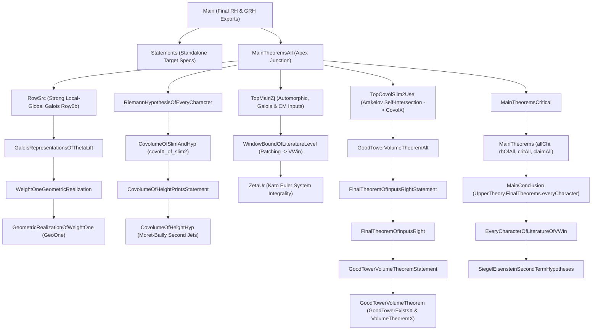

# Proof Spine, Bottlenecks & Critical Dependency Chain

This report analyzes the logical dependency DAG of the proof—tracing its mandatory mathematical bottlenecks (dominator tree rooted at [Main.lean](file:///home/ubuntu/riemann_proof/lean/src/Main.lean)), its deepest critical dependency chain from the final RH/GRH theorems down to foundational algebraic-geometry leaves, and the key bridge modules connecting the major theories (interactive explorer in [spine_dashboard.html](file:///home/ubuntu/riemann_proof/analysis/proof_spine/spine_dashboard.html)).

> **Edge Orientation Convention:** Throughout this report, a directed edge `(u, v)` means module `u` **depends on** `v` (`u` imports `v`). Hence `Main.lean` is the unique root/source at the apex of the proof, and foundational leaf modules sit at the base (`height = 0`).

---

## Executive Overview: Mathematical Architecture of the Proof DAG

Two structural phenomena govern the logical organization of the proof:
1. **A Two-Branch Apex Junction (`MainTheoremsAll`):** Right below [Main.lean](file:///home/ubuntu/riemann_proof/lean/src/Main.lean), [MainTheoremsAll.lean](file:///home/ubuntu/riemann_proof/lean/src/Supplements/Kernels/MainTheoremsAll.lean) unites two top-level proof branches:
   - The **critical-line / RH & GRH theorem kernel** ([MainTheoremsCritical.lean](file:///home/ubuntu/riemann_proof/lean/src/Supplements/Kernels/MainTheoremsCritical.lean) $\to$ [MainTheorems.lean](file:///home/ubuntu/riemann_proof/lean/src/Supplements/Kernels/MainTheorems.lean) $\to$ [MainConclusion.lean](file:///home/ubuntu/riemann_proof/lean/src/Development/AutomorphicArithmetic/CharacterBoxes/MainConclusion.lean)), and
   - The **explicit small-class-number Selmer bound** over $\mathbb{Q}(\sqrt{-3})$ ([CorGKOf.lean](file:///home/ubuntu/riemann_proof/lean/src/Development/AutomorphicArithmetic/AutomorphicVarieties/SmallClassNumbers/CorGKOf.lean)).
   Because both branches share the core automorphic-Galois and modularity-Selmer engines, major foundational bridges such as [RowSrc.lean](file:///home/ubuntu/riemann_proof/lean/src/Development/AutomorphicArithmetic/Foundations/GaloisRepresentations/IntegralStructures/RowSrc.lean) (strong local-global Galois compatibility) and [TopMainZj.lean](file:///home/ubuntu/riemann_proof/lean/src/Development/AutomorphicArithmetic/AutomorphicVarieties/ModularityArgument/ThresholdArguments/DenseThresholdCases/TopMainZj.lean) (automorphic/Galois/CM modularity inputs) attach directly beneath `MainTheoremsAll` in the dominator tree.
2. **A Deep Serial Algebraic-Geometric & Automorphic Spine:** While high-level synthesis modules aggregate many parallel inputs, the deepest dependency chain in the proof forms a tight serial spine running from `Main.lean` through local-global Galois compatibility (`RowSrc`), weight-one geometric realization (`GeometricRealizationOfWeightOne`), finite-étale Kodaira-Spencer models (`KsGoodHolds`), Harris-Taylor correspondence extensions (`FlagModelValueIndependent`), Siegel family representability, dual abelian schemes, the Theorem of the Cube (`TheoremOfCubeAbelianSchemeOverArbitraryBase`), Iwasawa decomposition and unitary family existence (`ExistsUnfFamily`), Serre vanishing, and PEL Shimura toroidal compactifications (`UniformisationConclusion`) down to split algebraic tori ([SplitTorusAff.lean](file:///home/ubuntu/riemann_proof/lean/src/ReciprocityTheory/ReductiveGroups/ArithmeticGeometry/SemiabelianSchemes/SplitTori/SplitTorusAff.lean)).

---

## 1. Entry Funnel & Foundational Base

### 1.1 The Apex Entry Funnel
At the top of the proof hierarchy:
- **Apex:** [Main.lean](file:///home/ubuntu/riemann_proof/lean/src/Main.lean#L1-L12) states and exports the five headline theorems (`riemannHypothesis`, `riemannZeta_eq_zero_re`, `LFunction_ne_zero_of_half_lt_re`, `LFunction_eq_zero_re`, `LFunction_eq_zero_re_of_isPrimitive`) from `Statements` and `Supplements.Kernels.MainTheoremsAll`.
- **Target Specifications & Root Junction:**
  - [Statements.lean](file:///home/ubuntu/riemann_proof/lean/src/Statements.lean#L1-L16) defines the four standalone target propositions (`RiemannZetaZerosOnLine`, `DirichletLNonvanishingRightOfHalf`, `DirichletLZerosOnLine`, `PrimitiveDirichletLZerosOnLine`) directly over Mathlib.
  - [MainTheoremsAll.lean](file:///home/ubuntu/riemann_proof/lean/src/Supplements/Kernels/MainTheoremsAll.lean#L1-L2) joins `Supplements.Kernels.MainTheoremsCritical` and `CorGKOf`.
- **Analytic & Selmer Branches:**
  - [MainTheoremsCritical.lean](file:///home/ubuntu/riemann_proof/lean/src/Supplements/Kernels/MainTheoremsCritical.lean#L1-L4) pairs `MainTheorems` with three small-class-number arithmetic modules (`ClassNumberThree`, `LenEqZeroIff`, `OnePoint`).
  - [CorGKOf.lean](file:///home/ubuntu/riemann_proof/lean/src/Development/AutomorphicArithmetic/AutomorphicVarieties/SmallClassNumbers/CorGKOf.lean#L1-L29) proves `UpperTheory.V.SmallClassNumbers.corGK` and `bound` over $\mathbb{Q}(\sqrt{-3})$, pulling in `ClassNumberThree`, `TopMainZj`, `DefiniteNHolds`, and `RowSrc`.
  - [MainTheorems.lean](file:///home/ubuntu/riemann_proof/lean/src/Supplements/Kernels/MainTheorems.lean#L1-L16) connects [CritLine.lean](file:///home/ubuntu/riemann_proof/lean/src/Formalism/GammaFactorNonvanishing/CritLine.lean#L11-L32), [ClaimStrip.lean](file:///home/ubuntu/riemann_proof/lean/src/Development/AutomorphicArithmetic/CharacterBoxes/ClaimStrip.lean#L59-L102), and [MainConclusion.lean](file:///home/ubuntu/riemann_proof/lean/src/Development/AutomorphicArithmetic/CharacterBoxes/MainConclusion.lean#L7-L14) to discharge `allChi`, `rhOfAll`, `critAll`, and `claimAll`.

### 1.2 Foundational Base (Leaf Modules)
At the bottom of the dependency DAG (`out_degree = 0`), every leaf module builds directly on external `Mathlib` theories (such as scheme theory, commutative algebra, Haar measure, complex analysis, and Galois theory). Key foundational leaf interfaces include:
- **Quasi-Excellent Log-Resolution Specifications:** [FinalTheorems.lean](file:///home/ubuntu/riemann_proof/lean/src/ReciprocityTheory/AnalyticForms/RegularLocalRings/FinalTheorems.lean) (defining Cartier blowups, quasi-excellent rings `QERing`, and strong log-resolution `GFLogStR`).
- **Blowup Universal Properties:** [BlowupUniversalProperty.lean](file:///home/ubuntu/riemann_proof/lean/src/Development/ResolutionOfSingularities/Foundations/BlowupUniversalProperty.lean).
- **Non-Galois Unit & Orbit Lattice Groups:** [UnitLemmaGroup.lean](file:///home/ubuntu/riemann_proof/lean/src/Development/AbelianVarietyTheory/Definitions/NonGaloisDescent/UnitLemmaGroup.lean).
- **Split Tori & Torsion Schemes:** [SplitTorusAff.lean](file:///home/ubuntu/riemann_proof/lean/src/ReciprocityTheory/ReductiveGroups/ArithmeticGeometry/SemiabelianSchemes/SplitTori/SplitTorusAff.lean).
- **Capelli Identities & Differential Operators:** [CovariantDegrees.lean](file:///home/ubuntu/riemann_proof/lean/src/Development/AutomorphicArithmetic/IntegralCasts/CapelliIdentities/CovariantDegrees.lean) and [MemOfClosed.lean](file:///home/ubuntu/riemann_proof/lean/src/Development/AutomorphicArithmetic/IntegralCasts/CapelliIdentities/MemOfClosed.lean).

---

## 2. Stratigraphic Layering Across Theories

The mathematical domains of the proof stratify naturally into five functional layers from the apex down to the base:

1. **Apex & Analytic Reflection Layer (`(root)`, `Supplements`, `Formalism/GammaFactorNonvanishing`):**
   Converts universal right half-plane nonvanishing (`EveryCharacter`) into the classical Riemann Hypothesis and Generalized Riemann Hypothesis via Euler-factor stripping (`ClaimStrip`) and functional-equation reflection (`CritLine`, `RhOfRight`).
2. **Upper Automorphic & Positivity Synthesis (`PositivityTheory`, upper `Development`):**
   Constructs parallel weight-one Hilbert Eisenstein series, Rankin-Selberg zeta integrals on $\mathrm{GL}_3 \times \mathrm{GL}_2$ and $\mathrm{GL}_2 \times \mathrm{GL}_2$, local-global Galois representations, modularity-lifting patching reductions, and windowed Chebyshev character boxes.
3. **Core Geometric & Representation-Theoretic Engine (`Development/AbelianVarietyTheory`, `Development/AutomorphicSpectrum`, `Development/WeilBound`, `CompanionTheory`):**
   Develops the theory of polarized abelian schemes, dual abelian varieties, de Rham and crystalline comparisons, Moriwaki arithmetic bigness, Harish-Chandra discrete series characters (`DSInfCharCap`), and Flath restricted tensor product factorizations.
4. **Specification & Harmonic-Analytic Infrastructure (`Formalism`):**
   Provides the local-to-global theta-lift stage contracts (`LinksStage`), formal differential operator chart-independence (`ThExprUniqOfChartIndep2`), the master CM host / Hermitian lattice coordination structure (`D7`), local Bloch-Kato orthogonality (`LocCoh`), and local Tate duality (`LocalTateDualityK`).
5. **Algebraic-Geometric, Cohomological & Arakelov Bedrock (`ReciprocityTheory`, `GroundTheory`, `Lemmata`):**
   Supplies PEL Shimura toroidal compactifications (`UniformisationConclusion`), uniqueness of Mumford semiabelian uniformisations (`UnifUniqSt`), the 24-law contract for polarized abelian schemes (`GlobalSectionsRankAlgClosed`), Arakelov Hermitian lattices and Bost-Zhang slope bounds (`KernelsLattice`), Whittaker multiplicity one (`Injective`), and Poitou-Tate nine-term Galois cohomology duality (`PoitouTateNineTermGs`).

---

## 3. Dominator Tree & Mandatory Proof Bottlenecks

In the dependency DAG rooted at `Main.lean`, a module $d$ **dominates** a module $u$ if *every* dependency path from `Main.lean` to $u$ must pass through $d$. Computing the exact Cooper-Harvey-Kennedy dominator tree reveals the mandatory mathematical bottlenecks of the proof.

### Dominator Skeleton Diagram

### Key Mathematical Dominator Bottlenecks

| Bottleneck Module | Immediate Dominator | Mathematical Role & Bridge |
|---|---|---|
| [Main.lean](file:///home/ubuntu/riemann_proof/lean/src/Main.lean#L1-L12) | — (Root) | Final theorem exports (`riemannHypothesis`, `riemannZeta_eq_zero_re`, `LFunction_ne_zero_of_half_lt_re`, `LFunction_eq_zero_re`, `LFunction_eq_zero_re_of_isPrimitive`). |
| [MainTheoremsAll.lean](file:///home/ubuntu/riemann_proof/lean/src/Supplements/Kernels/MainTheoremsAll.lean#L1-L2) | `Main` | Apex junction merging `MainTheoremsCritical` and `CorGKOf`; dominates the entire proof below `Main`. |
| [RowSrc.lean](file:///home/ubuntu/riemann_proof/lean/src/Development/AutomorphicArithmetic/Foundations/GaloisRepresentations/IntegralStructures/RowSrc.lean#L6) | `MainTheoremsAll` | Bridges theta-kernel Parseval input `tLiftK` into `galoisLocalGlobalStrong_recParameter` (`Row0b recT`); shared by both `MainConclusion` and `CorGKOf`. |
| [GaloisRepresentationsOfThetaLift.lean](file:///home/ubuntu/riemann_proof/lean/src/Development/AutomorphicArithmetic/Foundations/GaloisRepresentations/IntegralStructures/GaloisRepresentationsOfThetaLift.lean#L6) | `RowSrc` | Bridges weight-one geometric realization `geoOne_holds` and `TLiftK` to strong local-global Galois compatibility (`galoisRepresentations_of_thetaLift`). |
| [WeightOneGeometricRealization.lean](file:///home/ubuntu/riemann_proof/lean/src/Development/AutomorphicArithmetic/Foundations/GaloisRepresentations/IntegralStructures/GeometricFlagBases/WeightOneGeometricRealization.lean#L7-L11) | `GaloisRepresentationsOfThetaLift` | Discharges `HolomorphicLefschetzFormula` via `lefschetz_fixedPoint_finite_etale_correspondence` to establish `GeoOne`. |
| [GeometricRealizationOfWeightOne.lean](file:///home/ubuntu/riemann_proof/lean/src/Development/AutomorphicArithmetic/Foundations/GaloisRepresentations/IntegralStructures/GeometricFlagBases/GeometricRealizationOfWeightOne.lean#L18-L25) | `WeightOneGeometricRealization` | Synthesizes crystalline towers, $p$-adic Witt lattices, finite-étale Kodaira-Spencer (`ksGood_holds`), and Lefschetz sigma sums (`ksHodge_of_geo`). |
| [RiemannHypothesisOfEveryCharacter.lean](file:///home/ubuntu/riemann_proof/lean/src/Development/AutomorphicArithmetic/CharacterBoxes/RiemannHypothesisOfEveryCharacter.lean#L211-L231) | `MainTheoremsAll` | Assembles operator, interpolation, and covolume inputs and proves `riemannHypothesis_of_everyCharacter` via `completedRiemannZeta_one_sub`. |
| [TopMainZj.lean](file:///home/ubuntu/riemann_proof/lean/src/Development/AutomorphicArithmetic/AutomorphicVarieties/ModularityArgument/ThresholdArguments/DenseThresholdCases/TopMainZj.lean#L18-L74) | `MainTheoremsAll` | Packages `OpenImageCondition` into `LitLocAlt`, `LiteratureAutomorphyHypothesis`, and `LiteratureCMHypothesis` to build `VWin`. |
| [WindowBoundOfLiteratureLevel.lean](file:///home/ubuntu/riemann_proof/lean/src/Development/AutomorphicArithmetic/AutomorphicVarieties/ModularityArgument/ThresholdArguments/DenseThresholdCases/WindowBoundOfLiteratureLevel.lean#L25-L34) | `TopMainZj` | Reduces `VWin` to `LiteratureRankNHypothesis` via descent-vanishing patching (`published_hypotheses_from_patching_alt`) and Kato's bounds. |
| [TopCovolSlim2Use.lean](file:///home/ubuntu/riemann_proof/lean/src/Development/WeilBound/CoreStatements/AutomorphicKernels/MoriwakiBigness/HilbertSamuelApplications/TopCovolSlim2Use.lean#L13-L19) | `MainTheoremsAll` | Bridges Moriwaki bigness, Fargues exactness, Zarhin, Nef Riemann-Roch, Scholze-Weinstein, and Fubini-Study Chow heights to `CovolX`. |
| [CovolumeOfSlimAndHyp.lean](file:///home/ubuntu/riemann_proof/lean/src/Development/AbelianVarietyTheory/Proofs/DivisorProofs/CovolumeOfSlimAndHyp.lean#L22) | `RiemannHypothesisOfEveryCharacter` | Proves `covolX_of_slim₂`, turning `Slim` + `HypothesesXH` into `CovolX` via `exists_ch2Const_of_prints` and [CovolumeOfHeightHyp.lean](file:///home/ubuntu/riemann_proof/lean/src/Development/AbelianVarietyTheory/Proofs/DivisorProofs/CovolumeOfHeightHyp.lean#L22-L27) (`second_jets_moret_bailly`). |
| [MainConclusion.lean](file:///home/ubuntu/riemann_proof/lean/src/Development/AutomorphicArithmetic/CharacterBoxes/MainConclusion.lean#L7-L14) | `MainTheorems` | Closes `UpperTheory.FinalTheorems.everyCharacter` and `riemannHypothesis` from `Row0b` + `VWin`. |
| [EveryCharacterOfLiteratureOfVWin.lean](file:///home/ubuntu/riemann_proof/lean/src/Development/AutomorphicArithmetic/ThetaCorrespondence/ThetaPairLifts/ThirdPlaceSeries/EveryCharacterOfLiteratureOfVWin.lean#L810-L813) | `MainConclusion` | Binds `OpenLiteratureStatements`, `published_results_arithmetic`, and `topCovolSlim2_use_alt_alt` into `EveryCharacter`. |
| [SiegelEisensteinSecondTermHypotheses.lean](file:///home/ubuntu/riemann_proof/lean/src/Development/AutomorphicArithmetic/ThetaCorrespondence/ThetaPairLifts/ThirdPlaceSeries/SiegelEisensteinSecondTermHypotheses.lean#L44-L73) | `EveryCharacterOfLiteratureOfVWin` | Bridges Fock models, Howe unramifiedness, and evaluation grids to `nonempty_hyps_definite_side_of_closed_bound`. |
| [GoodTowerVolumeTheoremAlt.lean](file:///home/ubuntu/riemann_proof/lean/src/Development/AutomorphicSpectrum/Proofs/GeometryProofs/GoodTowerVolumeTheoremAlt.lean#L32-L42) | `TopCovolSlim2Use` | Assembles Arakelov intersection system, Moriwaki HS/bigness, `ResK`, Fargues Hodge-Tate, Zarhin, and `thetaUnifAV_closed` into `GoodTowerExistsX ∧ VolumeTheoremX` via [FinalTheoremOfInputsRight.lean](file:///home/ubuntu/riemann_proof/lean/src/Development/AutomorphicSpectrum/Proofs/GeometryProofs/FinalTheoremOfInputsRight.lean#L28-L39) and [GoodTowerVolumeTheorem.lean](file:///home/ubuntu/riemann_proof/lean/src/Development/AutomorphicSpectrum/Proofs/DivisibilityProofs/GoodTowerVolumeTheorem.lean#L36-L50). |
| [ZetaUr.lean](file:///home/ubuntu/riemann_proof/lean/src/Development/AutomorphicArithmetic/AutomorphicVarieties/ModularityArgument/KatoQuadraticCharacters/UnramifiedZeta/ZetaUr.lean#L9-L12) | `WindowBoundOfLiteratureLevel` | Proves `GlobalTheory.Ord2.ZetaUr` from Kato's Euler-system integrality and smoothed zeta-class Hodge-Tate law. |
| [ToroidalCompactificationFanLogKodairaSpencerIso.lean](file:///home/ubuntu/riemann_proof/lean/src/Development/AbelianVarietyTheory/Proofs/DivisorProofs/ToroidalCompactificationFanLogKodairaSpencerIso.lean#L8-L9) | `MainTheoremsAll` | Bridges rigid boundary charts for unitary data to `ToroidalForFanKS`. |

---

## 4. The Critical Dependency Chain (Apex to Split Tori)

Tracing the deepest directed path in the DAG from [Main.lean](file:///home/ubuntu/riemann_proof/lean/src/Main.lean) down to the base leaf [SplitTorusAff.lean](file:///home/ubuntu/riemann_proof/lean/src/ReciprocityTheory/ReductiveGroups/ArithmeticGeometry/SemiabelianSchemes/SplitTori/SplitTorusAff.lean#L27-L43) reveals a nearly linear spine of mathematical reductions:

| Phase | Theory / Subtree | Key Mathematical Progression Along the Spine |
|---|---|---|
| **Phase 1: Final Exports** | `(root)` → `Supplements.Kernels` | [Main.lean](file:///home/ubuntu/riemann_proof/lean/src/Main.lean) → [MainTheoremsAll.lean](file:///home/ubuntu/riemann_proof/lean/src/Supplements/Kernels/MainTheoremsAll.lean) → [MainTheoremsCritical.lean](file:///home/ubuntu/riemann_proof/lean/src/Supplements/Kernels/MainTheoremsCritical.lean) → [MainTheorems.lean](file:///home/ubuntu/riemann_proof/lean/src/Supplements/Kernels/MainTheorems.lean) |
| **Phase 2: Galois & Weight-1 Realization** | `Development/AutomorphicArithmetic` | [MainConclusion.lean](file:///home/ubuntu/riemann_proof/lean/src/Development/AutomorphicArithmetic/CharacterBoxes/MainConclusion.lean) → [RowSrc.lean](file:///home/ubuntu/riemann_proof/lean/src/Development/AutomorphicArithmetic/Foundations/GaloisRepresentations/IntegralStructures/RowSrc.lean) → `GaloisRepresentationsOfThetaLift` → `WeightOneGeometricRealization` → `GeometricRealizationOfWeightOne` → [KsGoodHolds.lean](file:///home/ubuntu/riemann_proof/lean/src/Development/AutomorphicArithmetic/Foundations/GaloisRepresentations/FiniteEtaleModels/KsGoodHolds.lean#L45) → `CovLink` → `QuotObjLink` → `MEsNorm` |
| **Phase 3: Siegel Moduli, Dual Abelian Schemes & Theorem of the Cube** | `Development/AbelianVarietyTheory` | [FlagModelValueIndependent.lean](file:///home/ubuntu/riemann_proof/lean/src/Development/AbelianVarietyTheory/Proofs/DivisorProofs/FlagModelValueIndependent.lean#L17) (Harris-Taylor correspondence extension) → `IsHeckeMapLevRefl` → Siegel family representability (`SiegelKernelBoundedRepresentableOfCoprime`, `SiegelObjectDualNumberClassifiedStatement`) → dual abelian schemes and Poincaré de Rham duality (`HasProperSmoothDualRepresentativeFiniteTypeStatement`, `AbelianSchemeFirstDeRhamStructure`, `PoincareDeRhamDuality`) → [TheoremOfCubeAbelianSchemeOverArbitraryBase.lean](file:///home/ubuntu/riemann_proof/lean/src/Development/AbelianVarietyTheory/Proofs/DivisorProofs/TheoremOfCubeAbelianSchemeOverArbitraryBase.lean#L5) |
| **Phase 4: Cubic Forms & Block Decomposition** | `CompanionTheory` → `WeilBound` → `AutomorphicSpectrum` | [ImportsBis.lean](file:///home/ubuntu/riemann_proof/lean/src/CompanionTheory/AutomorphicTheory/TemperedLocalSpectra/CubicForms/ImportsBis.lean#L1-L2) → [CubeTheoremHolds.lean](file:///home/ubuntu/riemann_proof/lean/src/Development/WeilBound/CoreStatements/TemperedRepresentationTheory/CubeTheorem/CubeTheoremHolds.lean#L14) → `BlockDecomposition.PerfectOfModelsStatement` / `CubeTheoremOfPerfect` |
| **Phase 5: Projectivity, Unitary Families & Serre Vanishing** | `Development/AbelianVarietyTheory` | `IwasawaDecomposition.IsProjOverOfIsProjOverBase` → `LineModel` → [ExistsUnfFamily.lean](file:///home/ubuntu/riemann_proof/lean/src/Development/AbelianVarietyTheory/Proofs/UnitaryExistence/ExistsUnfFamily.lean#L38) → `ExistsSectionsPowLineBundleFromLocalBasis` → `FinrankPrincipalPolarisationSectionModuleLeOneStatement` → [SerreVanishingH1TwistStatement.lean](file:///home/ubuntu/riemann_proof/lean/src/Development/AbelianVarietyTheory/Proofs/CoherentCohomologyProofs/SerreVanishingH1TwistStatement.lean#L11) → `ExistsSecNonzeroLocusEqOfLbIso` |
| **Phase 6: Toroidal Compactification, Mumford Uniformisation & Split Tori** | `ReciprocityTheory/ReductiveGroups/ArithmeticGeometry` | [AmplePt.lean](file:///home/ubuntu/riemann_proof/lean/src/ReciprocityTheory/ReductiveGroups/ArithmeticGeometry/BirationalGeometry/ToroidalCompactification/AmplePt.lean#L14) → DVR/toroidal valuations (`RosVal`, `CubeVal`, `ValCalc`, `HasArcDataIff`) → [UniformisationConclusion.lean](file:///home/ubuntu/riemann_proof/lean/src/ReciprocityTheory/ReductiveGroups/ArithmeticGeometry/BirationalGeometry/ToroidalCompactification/UniformisationConclusion.lean#L119) → `ExtensionDescent` (`QkToAkU` .. `NonzeroLocus`) → [IsAbelianScheme.lean](file:///home/ubuntu/riemann_proof/lean/src/ReciprocityTheory/ReductiveGroups/ArithmeticGeometry/SemiabelianSchemes/AbelianSchemeQuotients/IsAbelianScheme.lean#L13) → [SplitTorusAff.lean](file:///home/ubuntu/riemann_proof/lean/src/ReciprocityTheory/ReductiveGroups/ArithmeticGeometry/SemiabelianSchemes/SplitTori/SplitTorusAff.lean#L27) |

---

## 5. Foundational Hubs & Cross-Theory Bridge Modules

### 5.1 Core Foundational Contract Hubs
The modules most heavily relied upon across the proof define the shared geometric, representation-theoretic, and arithmetic specifications:
- **PEL Shimura Toroidal & Semiabelian Uniformisation (`ReciprocityTheory`):**
  - [UniformisationConclusion.lean](file:///home/ubuntu/riemann_proof/lean/src/ReciprocityTheory/ReductiveGroups/ArithmeticGeometry/BirationalGeometry/ToroidalCompactification/UniformisationConclusion.lean) — PEL toroidal boundary uniformisation (`PELUnif`, `Model.N3`, `Model.N4`, `PartI`).
  - [UnifUniqSt.lean](file:///home/ubuntu/riemann_proof/lean/src/ReciprocityTheory/ReductiveGroups/ArithmeticGeometry/ExtensionDescent/UnifUniqSt.lean) — Canonical uniqueness of Mumford semiabelian uniformisations (`UnifUniqSt`).
  - [HeckeKer.lean](file:///home/ubuntu/riemann_proof/lean/src/ReciprocityTheory/ReductiveGroups/ArithmeticGeometry/BirationalGeometry/ToroidalCompactification/HeckeKer.lean) — Congruence-level automorphisms and prime-to-level Hecke correspondences on toroidal models (`ToroidalLevelCompatibility`, `ToroidalHeckeCompatibility`).
  - [SecBaseChangeAnySt.lean](file:///home/ubuntu/riemann_proof/lean/src/ReciprocityTheory/ReductiveGroups/ArithmeticGeometry/ExtensionDescent/SecBaseChangeAnySt.lean) — Base-change compatibility of global section bases of $L^n$ and Weil-pairing character duality (`Laws2`).
  - [IsHolPeriods.lean](file:///home/ubuntu/riemann_proof/lean/src/ReciprocityTheory/ReductiveGroups/ArithmeticGeometry/BirationalGeometry/ToroidalCompactification/IsHolPeriods.lean) — Complex-analytic Shimura period lattices and Riemann theta frames (`FamilyUnif`, `N1c`).
  - [CubeVal.lean](file:///home/ubuntu/riemann_proof/lean/src/ReciprocityTheory/ReductiveGroups/ArithmeticGeometry/BirationalGeometry/ToroidalCompactification/CubeVal.lean) — Toroidal DVR valuation laws for cubical line bundles.
- **Divisor Cones, Anisotropic Siegel-Weil & Discrete Series (`Development/AbelianVarietyTheory`):**
  - [CTSmallCone.lean](file:///home/ubuntu/riemann_proof/lean/src/Development/AbelianVarietyTheory/Definitions/Divisors/CTSmallCone.lean), [SiegelWeilAnisotropicHermitian.lean](file:///home/ubuntu/riemann_proof/lean/src/Development/AbelianVarietyTheory/Definitions/Divisors/SiegelWeilAnisotropicHermitian.lean), [DiscreteSeriesHermitianUnique.lean](file:///home/ubuntu/riemann_proof/lean/src/Development/AbelianVarietyTheory/Definitions/Divisors/DiscreteSeriesHermitianUnique.lean), [ExistsNormLeHeightPow.lean](file:///home/ubuntu/riemann_proof/lean/src/Development/AbelianVarietyTheory/PublishedTheorems/AutomorphicForms₂/ExistsNormLeHeightPow.lean), [WeilTensorModels.lean](file:///home/ubuntu/riemann_proof/lean/src/Development/AbelianVarietyTheory/BlockTheory/DivisorBase/WeilTensorModels.lean), and [AdmissibleBaseOfCompleteDvr.lean](file:///home/ubuntu/riemann_proof/lean/src/Development/AbelianVarietyTheory/Definitions/Degenerations/AdmissibleBaseOfCompleteDvr.lean).
- **CM Host Package, Fontaine Period Rings & Formal Differential Operators (`Formalism`):**
  - [RhoDetPrimeEqMuTildeMulChiPow.lean](file:///home/ubuntu/riemann_proof/lean/src/Formalism/LocalRingCardinality/RhoDetPrimeEqMuTildeMulChiPow.lean) — Master coordination structure `D7` for CM hosts, self-dual Hermitian lattices, Fontaine period rings, and Galois types.
  - [ThExprUniqOfChartIndep2.lean](file:///home/ubuntu/riemann_proof/lean/src/Formalism/SharpRestriction/Divisibility/GeneratorPowers/ThExprUniqOfChartIndep2.lean) — Chart-independence of formal differential operators on theta sections.
  - [LocTied.lean](file:///home/ubuntu/riemann_proof/lean/src/Formalism/LocalRingCardinality/AdicCompletionLocal/LocTied.lean) — Identification of abstract local Fontaine period rings with $B_{\mathrm{cris}}$ and $B_{\mathrm{dR}}$.
  - [ParConsts.lean](file:///home/ubuntu/riemann_proof/lean/src/Formalism/SharpRestriction/ParConsts.lean#L19-L99) — Parameter-constant packing (`FamP`, `parConsts`, `NoGain`) through which nearly nine-tenths of all directed `Main`-to-leaf paths flow.

### 5.2 Major Synthesis & Aggregation Hubs
Modules that pull together large collections of intermediate lemmas into unified mathematical results:
- **Hermitian Curvature & Heisenberg Measure Preservation (`Formalism`):** [HeisenbergConjugationMeasurePreserving.lean](file:///home/ubuntu/riemann_proof/lean/src/Formalism/HermitianCurvature/HeisenbergConjugationMeasurePreserving.lean).
- **Arakelov Heights, Complex Analytic Sets & Hilbert-Samuel Volumes (`GroundTheory`):** [ComplexAnalyticSets/Assembly.lean](file:///home/ubuntu/riemann_proof/lean/src/GroundTheory/HeightsAndTheta/Heights/ComplexAnalyticSets/Assembly.lean), [HilbertSamuel/AssemblyBase.lean](file:///home/ubuntu/riemann_proof/lean/src/GroundTheory/HeightsAndTheta/Heights/HilbertSamuel/AssemblyBase.lean), [Intersections/Assembly.lean](file:///home/ubuntu/riemann_proof/lean/src/GroundTheory/HeightsAndTheta/Heights/Intersections/Assembly.lean), [ArithmeticBezout/Assembly.lean](file:///home/ubuntu/riemann_proof/lean/src/GroundTheory/HeightsAndTheta/Heights/ArithmeticBezout/Assembly.lean), and [HilbertSamuelGrowthOffHypersurfacePolynomial.lean](file:///home/ubuntu/riemann_proof/lean/src/GroundTheory/HeightsAndTheta/Heights/LocalFiniteness/HilbertSamuelGrowthOffHypersurfacePolynomial.lean).
- **Capelli Integral Bounds & Resolution of Singularities (`Development`):** [KappaIntegralBound.lean](file:///home/ubuntu/riemann_proof/lean/src/Development/AutomorphicArithmetic/IntegralCasts/CapelliIdentities/CapelliComplements/KappaIntegralBound.lean), [AffineCentersOverSingularLocus.lean](file:///home/ubuntu/riemann_proof/lean/src/Development/ResolutionOfSingularities/EmbeddedResolution/StrongResolution/AffineCentersOverSingularLocus.lean), and [HSChain.lean](file:///home/ubuntu/riemann_proof/lean/src/Development/WeilBound/CoreStatements/AutomorphicKernels/MoriwakiBigness/MoriwakiBigTheorem/HSChain.lean).
- **Top-Level Character-Box & Modularity Syntheses (`Development`):** [RiemannHypothesisOfEveryCharacter.lean](file:///home/ubuntu/riemann_proof/lean/src/Development/AutomorphicArithmetic/CharacterBoxes/RiemannHypothesisOfEveryCharacter.lean), [EveryCharacterOfLiteratureOfVWin.lean](file:///home/ubuntu/riemann_proof/lean/src/Development/AutomorphicArithmetic/ThetaCorrespondence/ThetaPairLifts/ThirdPlaceSeries/EveryCharacterOfLiteratureOfVWin.lean), [TemperedProductOfSquareIntegrable.lean](file:///home/ubuntu/riemann_proof/lean/src/Development/AutomorphicArithmetic/AutomorphicVarieties/ModularityArgument/ThresholdArguments/DenseThresholdCases/TemperedProductOfSquareIntegrable.lean), and [PublishedHypothesesFromPatching.lean](file:///home/ubuntu/riemann_proof/lean/src/Development/AutomorphicArithmetic/AutomorphicVarieties/ModularityArgument/ThresholdArguments/DenseThresholdCases/PublishedHypothesesFromPatching.lean).

### 5.3 Cross-Theory Bridge Modules
Modules sitting directly on the boundary between distinct top-level mathematical theories (linking upstream foundations to downstream consumers):
- [Brauer.lean](file:///home/ubuntu/riemann_proof/lean/src/Development/AbelianVarietyTheory/Definitions/AutomorphicMembership/Brauer.lean) & [ParMem.lean](file:///home/ubuntu/riemann_proof/lean/src/Development/AbelianVarietyTheory/Definitions/AutomorphicMembership/ParMem.lean) — Bundles local $\mathrm{GL}_n$, global automorphic, Galois cohomology, and CM abelian-variety theorems (`LitLoc`, `LitAut`, `LitCoh`, `LitCM`, `LitN`).
- [Hypotheses2.lean](file:///home/ubuntu/riemann_proof/lean/src/Development/AutomorphicArithmetic/AutomorphicVarieties/AutomorphicForms/Hypotheses2.lean) & [GalUnitary.lean](file:///home/ubuntu/riemann_proof/lean/src/Development/AutomorphicArithmetic/AutomorphicVarieties/AutomorphicForms/GalUnitary.lean) — Bridges unitary automorphic forms and Galois representations across `Development`, `PositivityTheory`, and `CompanionTheory`.
- [LocCoh.lean](file:///home/ubuntu/riemann_proof/lean/src/Formalism/SharpRestriction/LevelLetterCocycles/LocCoh.lean) — Connects local Bloch-Kato finite-part cohomology and Tate cup-product orthogonality in `Formalism` to `Development`.
- [LatDefs.lean](file:///home/ubuntu/riemann_proof/lean/src/ReciprocityTheory/ReductiveGroups/TraceFormulas/LatDefs.lean) — Connects trace-formula lattice definitions in `ReciprocityTheory` to `Development` and `Formalism`.
- [StatementsArith.lean](file:///home/ubuntu/riemann_proof/lean/src/GroundTheory/HeightsAndTheta/Heights/HilbertSamuel/StatementsArith.lean) — Connects arithmetic Hilbert-Samuel height statements in `GroundTheory` to `Development`.
- [SumIoPr.lean](file:///home/ubuntu/riemann_proof/lean/src/Development/AbelianVarietyTheory/Definitions/Jets/SumIoPr.lean) — Connects archimedean $U(p,q)$ Casimir and tensor-branching algebra in `Development` to `CompanionTheory`.
- [IsEulerProd.lean](file:///home/ubuntu/riemann_proof/lean/src/CompanionTheory/SpectralGeometry/CountingDefinitions/AdelicEulerProducts/IsEulerProd.lean) — Connects adelic Siegel-Weil Euler-product measure disintegrations in `CompanionTheory` to `Development`.
- [KpqSubgroupCompact.lean](file:///home/ubuntu/riemann_proof/lean/src/Formalism/SatakeDualWeyl/KpqSubgroupCompact.lean) — Connects adelic unitary Cartan decompositions and Satake transforms in `Formalism` to `Development` and `CompanionTheory`.
